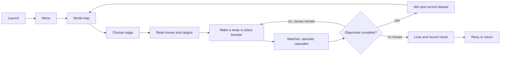

# Pho Logic Game Design Document

> [!IMPORTANT]
> Pho Logic is a student portfolio project. This GDD is an as-built blueprint for version `1.0.0+6`: implemented behavior comes from the repository's Dart code and 25 stage files. Production recommendations are labelled and are not claims about current features.

| Document field | Value |
| --- | --- |
| Title | Pho Logic |
| Genre | Casual match-3 puzzle |
| Current format | 25-stage MVP campaign |
| Theme | Vietnamese food, festival, and street-culture imagery |
| Input | Tap two adjacent tiles; drag inventory boosters onto board tiles |
| Core board | 8 rows x 7 columns with stage-authored voids and blockers |
| Current store target | [Google Play](https://play.google.com/store/apps/details?id=com.cuongtmodwork.phologic) |
| Project status | Student portfolio project, not a commercial-production claim |
| Document status | As-built design specification with clearly separated recommendations |
| Last reviewed against source | 2026-08-12 |

## Reading Conventions

- **Current** means implemented in code or stage data.
- **Design intent** explains the coherent goal expressed by the implemented systems.
- **Recommended** means a proposed quality improvement, not a shipped feature.

The [architecture reference](ARCHITECTURE.md) is authoritative for engineering boundaries and implementation risks.

## High Concept

Pho Logic is a compact, tap-driven match-3 game where Vietnamese food tiles create readable patterns and festival-themed specials turn a single swap into a staged audiovisual payoff. Players complete collection targets within a move budget while navigating shaped boards and late-campaign scooter blockers.

The project differentiates itself through its subject matter and feedback language rather than by replacing familiar match-3 fundamentals. Food icons make the base board approachable; party poppers, firecrackers, sticky rice, a dragon fly, lanterns, bamboo, lotus art, and scooters carry the Vietnamese-inspired identity through UI and game effects.

## Design Goals

### 1. Readable Before Spectacular

The player should understand why a swap is valid, which tiles will clear, what an objective needs, and where a special will act. VFX can be expressive, but logical state must remain recoverable after every animation.

### 2. Vietnamese Identity in Play

The theme is not limited to a title treatment. Regular tiles, world art, blockers, music, particles, and special names should reinforce the cultural direction while remaining legible as game objects.

### 3. Short, Complete Turn Arcs

Each valid action follows a clear rhythm: choose, swap, resolve, cascade, stabilize, evaluate. Invalid actions return the board without spending a move.

### 4. Pattern Mastery

Depth comes from learning four creation patterns, five special effects, combination behavior, shaped-board constraints, and objective pressure.

### 5. Data-Driven Iteration

Stage targets, move budgets, board topology, blockers, and spawn weights live in JSON so tuning can occur without modifying the rule engine.

## Audience and Play Context

**Design target:** players who already understand or can quickly infer adjacent-swap match-3 controls and want short, visually expressive puzzle sessions.

No user research, retention data, age segmentation, difficulty telemetry, or accessibility study is checked into this repository. The target above is a design definition, not a measured audience claim.

The app has project wrappers for Android, iOS, web, Windows, macOS, and Linux. Native mobile orientation is locked by the app bootstrap. The Google Play link is the primary public store link supplied for this portfolio.

## Player Experience Summary



## Core Rules

### Board

- Logical dimensions are 8x7 in all 25 current stages.
- A stage can mark beds as void with `bedMap == -1`; voids are outside play.
- A scooter blocker occupies a playable cell without an underlying tile.
- Regular tiles use IDs `1..6`.
- Special tiles use IDs `101..105`.
- New tiles enter only through refill or explicit special placement/creation.

### Input

1. Tap a tile to select it.
2. Tap an orthogonally adjacent tile to attempt a swap.
3. Non-adjacent selection changes the selected tile rather than performing a distant swap.
4. Input is locked while the asynchronous turn resolves.

Inventory boosters use a different gesture: drag a booster from the belt and drop it on a playable regular tile.

### Valid Swap

A swap succeeds when the simulated result:

- Creates at least one horizontal or vertical line of three or more matching regular tiles.
- Creates a same-type regular 2x2 block around the swapped coordinates.
- Involves at least one special tile.

An invalid swap animates to the candidate position and returns to the original board. It does not consume a move.

### Resolution Order

1. Detect line matches and the swap-local 2x2 pattern.
2. Select non-overlapping special creation candidates by priority.
3. Resolve a special-to-special combination or normal activation.
4. Capture regular victim types for objective accounting.
5. Play special and clear feedback at the effect's required timing.
6. Clear tiles and eligible adjacent blockers.
7. Apply gravity within playable, blocker-separated column segments.
8. Refill with weighted regular tiles.
9. Resolve automatic line or 2x2 cascades.
10. Shuffle if the stable board has no special and no possible move.
11. Spend one move for the successful player action.

The cascade safety limit is 10 passes.

### Objectives and Terminal States

Stage JSON currently defines `collect` objectives only. Each specifies a regular `tileId` and target count. Cleared regular victims increment every matching objective, capped at its target.

Stages that start with scooters have an additional implicit requirement: all initial blockers must be removed. This requirement is derived from the initial blocker count, not an explicit objective record.

| State | Rule |
| --- | --- |
| Win | Every collection target is met and every required scooter is cleared |
| Lose | Moves reach zero before the win condition |
| Continue | The stage is neither won nor lost |
| No possible match | Display a non-dismissible wait modal while the board shuffles, then continue |

There is no score, star rating, timer, lives system, energy system, or partial-success state in the current implementation.

## Regular Tile Catalog

Names below are derived from the checked-in asset filenames.

| ID | Tile | Runtime asset reference | Objective role |
| ---: | --- | --- | --- |
| `1` | Banh mi | `assets/sprites/banh_mi.png` | Collectible regular tile |
| `2` | Banh xeo | `assets/sprites/banh_xeo.png` | Collectible regular tile |
| `3` | Ca phe trung | `assets/sprites/ca_phe_trung.png` | Collectible regular tile |
| `4` | Goi cuon | `assets/sprites/goi_cuon.png` | Collectible regular tile |
| `5` | Pho bowl | `assets/sprites/pho_bowl.png` | Collectible regular tile |
| `6` | Rau muong | `assets/sprites/rau_muong.png` | Collectible regular tile |

Regular tile images are served by the runtime tile atlas in `assets/sprites/texture.png` with `texture.json` metadata. The path values in stage JSON act as logical asset identifiers for atlas-aware loading.

## Special Tiles

### Creation and Activation

| ID | Special | Creation pattern | Activation |
| ---: | --- | --- | --- |
| `101` | Horizontal Party Popper | Exactly four regular tiles in a horizontal line | Clears playable cells along its row |
| `102` | Vertical Party Popper | Exactly four regular tiles in a vertical line | Clears playable cells along its column |
| `103` | Sticky Rice Bomb | Exactly five regular tiles in a straight line | Clears every regular tile matching the regular swap partner |
| `104` | Firecracker | Intersecting horizontal/vertical runs whose union is 5 or 6 cells | Clears a centered playable 3x3 area |
| `105` | Dragon Fly | Same-type regular 2x2 around the swap | Clears itself, its swap partner, and one deterministic additional target |

When patterns overlap, creation priority is Sticky Rice, Firecracker, Dragon Fly, then Party Popper. Only non-overlapping candidates survive the greedy selection pass.

The spawn coordinate normally preserves a tile involved in the player's swap:

1. Prefer the destination/`swapB` coordinate when it belongs to the pattern.
2. Otherwise prefer `swapA`.
3. Otherwise use a deterministic center, intersection, or top-left fallback.

### Feedback Contract

Every special needs three readable moments:

1. **Anticipation:** shake, tint, rotate, or otherwise identify the source.
2. **Travel/impact:** show the row projectile, flight target, or blast center.
3. **Board confirmation:** remove victims, play particles/audio, then settle gravity.

The current implementation has dedicated VFX classes for all five specials and a separate dual Sticky Rice effect. The tables below use checked-in GIF captures for the distinct visual power families; the vertical Party Popper follows the same timing contract as the row-clearing Party Popper.

| Party Popper | Sticky Rice Bomb |
| --- | --- |
|  |  |

| Firecracker | Dragon Fly |
| --- | --- |
|  |  |

### Special Combinations

The game uses pair-specific ordered effects rather than a generic "combine affected sets" rule.

| Combination | Current result |
| --- | --- |
| Horizontal + Horizontal | Clear both source rows |
| Vertical + Vertical | Clear both source columns |
| Horizontal + Vertical | Clear one row and one column; effect order follows swap orientation |
| Firecracker + Firecracker | One 3x3 clear at the activated source |
| Sticky Rice + Sticky Rice | Clear all regular tiles |
| Dragon Fly + Dragon Fly | Perform up to two Dragon Fly pre-hit steps |
| Firecracker + Horizontal/Vertical | Firecracker 3x3 only |
| Sticky Rice + Horizontal | Clear a selected regular type, then clear a row |
| Sticky Rice + Vertical | Clear a selected regular type, then clear a column |
| Sticky Rice + Firecracker | Clear a selected regular type, then clear a 3x3 area |
| Dragon Fly + Horizontal/Vertical | Pre-hit a regular target, then clear a row or column |
| Dragon Fly + Firecracker | Pre-hit a regular target, then clear a 3x3 area |
| Dragon Fly + Sticky Rice | Pre-hit a regular target, then clear that regular type when valid |

Specials caught inside another special's clear area are removed without activating their own VFX. The current system therefore limits chain-reaction ambiguity and overlapping animations.

## Scooter Blocker

The scooter appears in stages 22-25.

| Property | Current rule |
| --- | --- |
| Board occupancy | Occupies a cell without an underlying tile |
| Swap | Cannot be swapped |
| Gravity | Acts as a barrier; tiles do not pass through |
| Damage source | Adjacent regular match clear only |
| Special interaction | Special clears do not currently break adjacent scooters |
| Completion | Every scooter present at stage start must be cleared to win |
| Feedback | Scooter exit animation, particles, and scooter SFX |


The "regular match only" rule is encoded both in stage data metadata and controller behavior. If design changes to let specials damage scooters, the GDD, stage notes, clear accounting, and tests must change together.

## Booster Inventory

The five specials also function as inventory boosters.

- Counts default to zero.
- The belt displays IDs `101, 102, 103, 104, 105`.
- A booster can replace only a regular tile on a playable cell.
- Placement does not consume a move by itself.
- Inventory persists locally through `SharedPreferences`.
- Successful placement attempts to spend one inventory item.

### Prototype Reward Loop

The active menu and pause flows use a 45-second local cooldown and grant two of every special. This is useful for testing the complete booster surface, but it is not a sustainable progression or commercial economy.

The repository also retains an `app-ads.txt` file and documents a demo AdMob exercise performed for learning mobile publishing. The current dependency manifest does not include a Google Mobile Ads SDK. Advertising is not part of the core GDD.

**Recommended before any public economy claim:** define an intentional source/sink model, make placement and spend atomic, replace test cooldown values, and align privacy/store disclosures with the exact release build.

## Campaign and Progression

### Observed Structure

The campaign data expresses four practical bands:

1. **Stages 1-3:** full-board introduction, then voids and a second collection objective.
2. **Stages 4-20:** shaped-board variations with one or two collection objectives and authored difficulty labels from medium to very hard.
3. **Stage 21:** an explicit power-up testing arena with every special pre-placed and 50 moves.
4. **Stages 22-25:** late-campaign scooter stages that combine blockers, shaped boards, and two or three collection objectives.

This banding is an interpretation of checked-in data, not a claim that tutorial messaging or formal difficulty validation exists.

### Stage Specification

`Voids` counts `-1` entries in `tileMap`; `Scooters` counts `-2` entries. All boards are 8x7.

| Stage | Authored difficulty | Moves | Voids | Scooters | Collection objectives |
| ---: | --- | ---: | ---: | ---: | --- |
| 1 | easy | 16 | 0 | 0 | Pho bowl x14 |
| 2 | easy | 18 | 16 | 0 | Pho bowl x12 |
| 3 | easy | 17 | 16 | 0 | Pho bowl x12; Ca phe trung x6 |
| 4 | medium | 18 | 17 | 0 | Pho bowl x13; Ca phe trung x6 |
| 5 | medium | 17 | 10 | 0 | Pho bowl x12; Banh xeo x7 |
| 6 | medium | 18 | 8 | 0 | Pho bowl x14; Ca phe trung x10 |
| 7 | medium | 19 | 20 | 0 | Banh mi x14; Rau muong x14 |
| 8 | medium | 18 | 18 | 0 | Goi cuon x12; Ca phe trung x8 |
| 9 | medium | 20 | 4 | 0 | Pho bowl x14; Banh xeo x10 |
| 10 | medium | 20 | 11 | 0 | Banh mi x14; Pho bowl x10 |
| 11 | hard | 22 | 9 | 0 | Rau muong x16; Banh xeo x11 |
| 12 | hard | 21 | 14 | 0 | Pho bowl x14; Ca phe trung x10 |
| 13 | hard | 24 | 16 | 0 | Rau muong x18; Banh xeo x12 |
| 14 | medium | 22 | 12 | 0 | Goi cuon x14; Banh mi x12 |
| 15 | hard | 19 | 14 | 0 | Banh xeo x16; Pho bowl x12 |
| 16 | medium | 20 | 8 | 0 | Pho bowl x14; Ca phe trung x10 |
| 17 | hard | 18 | 12 | 0 | Banh xeo x18; Pho bowl x12 |
| 18 | hard | 17 | 16 | 0 | Goi cuon x20; Ca phe trung x12 |
| 19 | hard | 16 | 4 | 0 | Banh xeo x22; Pho bowl x14 |
| 20 | very_hard | 15 | 28 | 0 | Banh mi x24; Ca phe trung x14 |
| 21 | easy | 50 | 0 | 0 | Banh mi x18; Pho bowl x8 |
| 22 | medium | 25 | 16 | 10 | Banh xeo x20; Goi cuon x16 |
| 23 | hard | 26 | 0 | 12 | Ca phe trung x22; Pho bowl x18 |
| 24 | hard | 28 | 24 | 10 | Banh mi x20; Rau muong x16 |
| 25 | very_hard | 30 | 24 | 14 | Goi cuon x24; Banh xeo x20; Rau muong x14 |

### Spawn Weight Progression

Spawn weights are stage-authored, not globally constant.

- Stage 1 makes Pho bowl less frequent than the other regular tiles.
- Stage 2 slightly raises Pho bowl's weight.
- Stage 3 lowers Ca phe trung and Pho bowl relative to several other tiles.
- Stages 4-20 share the same regular-weight profile.
- Stage 21 includes all five specials as fixed tile definitions with zero weight and pre-places them in `tileMap`; it is a test arena, not normal refill content.
- Stages 22-25 use four distinct profiles and increasingly favor IDs `5` and `6` in later stages.

Refill must never select a special tile. Any tile definition with weight zero requires care because the current validator rejects non-positive weights even though stage 21 uses zero for fixed specials.

## Balance Framework

### Current Tuning Levers

| Lever | Effect |
| --- | --- |
| Move budget | Hard cap on valid player actions |
| Objective target | Required number of matching regular victims |
| Number of objectives | Competes for attention and available board colors |
| Spawn weights | Changes expected access to each objective tile |
| Playable-cell count | Changes match space, cascade potential, and mobility |
| Shape topology | Creates narrow channels and disconnected gravity behavior |
| Scooter count/placement | Removes swappable cells and partitions gravity |
| Fixed specials | Creates a scripted advantage, currently used by stage 21 |
| Booster availability | Can inject a chosen special without spending a move |

### Required Playtest Evidence

No completion-rate or move-efficiency telemetry is present. A serious balance pass should record, per stage:

- Attempts and completion rate.
- Median moves remaining on win.
- Failure state: objective shortfall, scooters remaining, or dead-board friction.
- Objective progress per move.
- Specials created and activated.
- Shuffle frequency.
- Booster use and resulting win-rate delta.
- First-attempt versus repeat-attempt success.

Do not tune from authored difficulty labels alone. Labels are metadata; player outcomes are evidence.

### Stage Acceptance Criteria

A stage is ready for a portfolio build when:

1. It parses and passes schema/content validation.
2. It initializes without unintended matches when `allowInitialMatches` is false.
3. It has at least one legal move.
4. Every objective references a regular tile available to the stage.
5. Blockers and voids match the intended visual shape.
6. The objective is achievable without relying on inventory boosters.
7. Win and lose states have been exercised.
8. Ten or more seeded simulations or structured manual runs show no infinite cascade or unrecoverable state.

The repository does not currently automate this gate.

## Screen and UX Specification

### Menu

The JSON-authored menu includes:

- Pho Logic logo.
- Play button leading to the world map.
- Boost button invoking the prototype reward path.
- Help button.
- Settings button.

Menu BGM starts on this screen. On web, the app retries playback after the first user interaction when autoplay is blocked.

### World Map

The world screen presents five stage lanterns at a time across five pages. It includes previous/next page controls, animated clouds and bamboo, a home action, and a stage-progress modal.

The stage-progress display uses the latest stored result for each stage. Current code does not enforce sequential locking; stage lanterns route directly to their corresponding gameplay stage.


### Gameplay HUD

The gameplay design is authored in a 1080x1920 coordinate space and contain-scaled into the device safe area.

| Region | Current purpose |
| --- | --- |
| Top HUD | Move counter, collection objectives, pause action |
| Center | Board frame and Flame viewport |
| Bottom HUD | Five draggable booster slots |
| Decoration | Lucky cat, lotus, bamboo-themed background |

The board rectangle is `x=120, y=325, w=850, h=1260` in design coordinates. `BoardGame` independently fits and centers the 8x7 logical grid inside that viewport.


### Modal Behavior

| Modal | Trigger | Actions |
| --- | --- | --- |
| Pause | Pause button | Resume or leave through pause-screen controls |
| Win | All requirements complete | Restart, next/world, or home |
| Lose | Zero moves before win | Retry or home |
| No moves | Stable board has no legal move and no special | Non-dismissible 1.5-second shuffle wait |
| Settings | Menu settings action | Language and feedback controls |
| Help | Menu/help flow | Scrollable language-specific instructions |

### Accessibility Status

**Current:**

- Objective icons and numeric counts communicate target state.
- Special effects combine motion, particles, and audio.
- Help content has English and Vietnamese JSON variants.
- Settings persist the selected language.

**Not established in source:**

- Color-blind alternatives.
- Reduced-motion mode.
- Haptic settings.
- Text scaling policy for sprite-number HUD values.
- Screen-reader semantics for board cells and drag/drop boosters.
- Keyboard/gamepad board navigation.

**Recommended:** treat these as explicit requirements before claiming broad accessibility. Do not rely on color, animation, or audio alone for any gameplay-critical state.

## Art Direction

### Visual Pillars

1. **Vietnamese food as readable symbols:** each regular tile must remain distinct at board size.
2. **Festival energy:** red, yellow, teal, green, and celebratory effects support the party-popper/firecracker language.
3. **Crafted world framing:** bamboo, lanterns, clouds, lotus art, and the lucky cat frame the functional board without obscuring it.
4. **Impact-specific particles:** crumbs, splashes, leaves, glass, sparkles, and scooter particles connect clears to their source objects.

The logo and gameplay presentation should be the first visual signal in portfolio materials; diagrams and source explanations are supporting material.

### Asset Classes

| Class | Runtime examples |
| --- | --- |
| Regular tiles | Six atlas sprites |
| Specials | Five standalone PNG power-up sprites |
| Blockers | Scooter blocker plus two scooter particle sprites |
| Match particles | Bread crumbs, glass, soup splash, leaves, sparkles, and related effects |
| UI frames | Board, top HUD, bottom HUD, pause button |
| World art | Background, bamboo, clouds, dragon, and 25 lantern sprites |
| Outcomes | Win and lose boards |

The portfolio copies under `images/`, `gameplay/`, `world_screen/`, and `gif/` support public documentation and are separate from the runtime asset manifest.

## Audio Direction

### Runtime Audio Architecture

The implementation separates continuous background music from event-driven feedback:

| Responsibility | Implementation | Current behavior |
| --- | --- | --- |
| Background music | `BgmManager` with one `audioplayers` `AudioPlayer` | Loops tracks, persists music state and volume, and performs a 400 ms fade when changing tracks |
| Sound effects | `SfxManager` with Flame `AudioPool` instances | Preloads each manifest entry and permits overlapping playback up to a code-owned pool size |
| SFX tuning | `assets/audio/sfx_tuning.json` | Defines master gain plus per-effect volume, cooldown, and playback delay |
| Player settings | `SharedPreferences` | Persists independent music and sound enable/volume values |

The menu and gameplay call their dedicated BGM methods. A festival track is declared and playable through `BgmManager`, but no active call site was found in the current source. Target BGM levels are `0.20` for menu, `0.10` for gameplay, and `0.15` for festival playback.

`SfxManager.playTuned()` accepts a `pitch` argument, but the current `AudioPool` path does not apply it. Sticky Rice therefore reuses `bloop.wav` without runtime pitch variation despite the enum/comment naming.

### Music Source and License Record

For this student portfolio project, the project author sourced the demo background music from [Pixabay's royalty-free music library](https://pixabay.com/music/). Pixabay describes its content as royalty-free and permits use subject to its Content License and prohibited uses; royalty-free does not mean public domain or free of conditions.

The repository does not currently retain the original track URLs, creator names, download dates, or downloaded license certificates. Before redistributing the audio or preparing another release, create a third-party asset ledger, recover those records, and verify each track against the [Pixabay Content License](https://pixabay.com/service/license-summary/) that applies to it. The SFX source history is not established by the current repository and is therefore not attributed to Pixabay here.

### Sound Event Map

| Context | Asset | Runtime intent |
| --- | --- | --- |
| Menu | `Menu_BGM.mp3` | Looping menu bed |
| Gameplay | `gameplay_BGM.mp3` | Lower-volume looping gameplay bed |
| Festival | `vietnamese-festival-bgm.mp3` | Declared optional festival bed; no current call site |
| Swap | `swipe.wav` | Tile movement confirmation |
| Match/clear | `bloop.wav` | Valid swap, regular clear, and Sticky Rice feedback |
| Party Popper | `party_popper_launch.wav` | Row/column projectile launch |
| Firecracker | `firecracker.wav` | Local explosion |
| Dragon Fly | `dragon_fly_launch.wav` | Targeting launch |
| Sticky Rice duo | `gong.wav` | `103 + 103` combination |
| Scooter | `scooter_sfx.wav` | Blocker exit sequence |
| Reward | `yay_cheer.mp3` | Booster/reward celebration |

### Audio Demos

The browser GDD provides native players for the checked-in files. The same assets can be opened directly from GitHub:

| Background music | Sound effects |
| --- | --- |
| [Menu BGM](assets/audio/bgm/Menu_BGM.mp3) | [Swipe](assets/audio/sfx/swipe.wav) |
| [Gameplay BGM](assets/audio/bgm/gameplay_BGM.mp3) | [Match bloop](assets/audio/sfx/bloop.wav) |
| [Festival BGM](assets/audio/bgm/vietnamese-festival-bgm.mp3) | [Party Popper](assets/audio/sfx/party_popper_launch.wav) |
|  | [Dragon Fly](assets/audio/sfx/dragon_fly_launch.wav) |
|  | [Firecracker](assets/audio/sfx/firecracker.wav) |
|  | [Sticky Rice duo gong](assets/audio/sfx/gong.wav) |
|  | [Scooter](assets/audio/sfx/scooter_sfx.wav) |
|  | [Reward cheer](assets/audio/sfx/yay_cheer.mp3) |

For portfolio and release builds, third-party audio rights should be reviewed file by file. This GDD does not infer license terms from filenames or earlier prose.

## Content Authoring

### Stage Data Contract

A stage file owns:

- Schema version and stage metadata.
- Rows and columns.
- Optional descriptive shape mask.
- Initial-match setting.
- Regular and fixed-special definitions.
- Bed and blocker type definitions.
- `bedMap` and `tileMap`.
- Move budget.
- Collection objectives.

The runtime meanings are:

```text
tileMap:
  0   weighted regular spawn
 -1   no tile / void
 -2   scooter blocker
 >=1  fixed tile ID

bedMap:
 -1   void / not playable
 >=0  playable bed ID
```

### Authoring Checklist

1. Keep `tileMap` and `bedMap` dimensions equal to `rows x columns`.
2. Make every void consistent across both matrices.
3. Define every fixed regular ID and objective ID in `tiles`.
4. Keep random-spawn regular weights positive.
5. Use special weight zero only for fixed/pre-placed specials; never include them in refill.
6. Declare blocker ID `-2` where scooters are used.
7. Confirm each objective is feasible within the move budget without a booster.
8. Run content validation and a deterministic initialization test.
9. Playtest edge rows/columns, narrow gravity channels, and all blocker adjacencies.
10. Verify the world route and next-stage flow.

### Layout Data Contract

Menu, world, and gameplay layouts use:

- `designWidth` and `designHeight`.
- Asset-backed elements with center anchors.
- Design-space position and size.
- Element-specific metadata such as objective or power-up slot type.
- `gridRect` for the gameplay board viewport.

The current design reference is 1080x1920. Art revisions must preserve the JSON coordinate contract or update both asset dimensions and layout metadata.

## Technical Design Constraints

The GDD depends on these engineering rules:

- `GridModel` is the source of board truth.
- Tile animation identity is `tileInstanceId`, not coordinate.
- UI and board rendering use different coordinate spaces.
- Rules complete asynchronously before another swap is accepted.
- VFX timing may call board clears, so visual and logical sequencing must remain explicit.
- Special clears do not currently damage adjacent scooters.
- Objective accounting ignores special IDs and counts regular victim IDs captured before mutation.

See [ARCHITECTURE.md](ARCHITECTURE.md) for full data flow and risk analysis.

## Quality Bar

### Functional

- All 25 stage assets load.
- Every valid action resolves to a stable board.
- Invalid actions preserve the board and move count.
- Collection progress reflects actual regular victims.
- Scooter stages cannot win while a required blocker remains.
- Special VFX and logical clears agree on source and target cells.
- A dead board becomes playable after shuffle.
- Progress and inventory survive restart.

### Presentation

- Board cells align with the frame at supported aspect ratios.
- Important HUD values never overlap artwork.
- Selection, invalid swap, special anticipation, impact, and completion are visually distinguishable.
- Audio events are synchronized and do not stack uncontrollably.
- Large clears reduce particle density enough to preserve readability.

### Portfolio Honesty

- Label the project as a student portfolio project.
- Separate implemented features from recommendations.
- Do not claim analytics, backend services, commercial monetization, accessibility coverage, or automated test coverage that the repository does not contain.
- Keep store, source, privacy, technical documentation, and GDD links consistent.

## Known Design and Implementation Gaps

| Priority | Gap | Design consequence |
| --- | --- | --- |
| High | Win auto-advance stops after stage 20 | Campaign navigation does not match the 25-stage world map |
| High | Booster placement is not rolled back when spend fails | Board and inventory can diverge |
| High | Meaningful automated tests are absent | Rule and content regressions are difficult to detect |
| Medium | Stage validation is not connected to runtime loading | Authoring errors can surface late |
| Medium | Stage 21 includes zero-weight specials while the validator rejects all non-positive tile weights | Test-arena content and validation policy disagree |
| Medium | Free-boost comments describe one-time behavior, but the active path uses a 45-second cooldown | Economy intent and implementation are inconsistent |
| Medium | Help text must remain aligned with actual blocker introduction at stage 22 | Tutorial expectations can diverge from content |
| Low | No explicit campaign locking | Players can select any lantern exposed by the world map |
| Low | No reduced-motion or non-drag booster alternative | Some interaction needs are unsupported |

## Production Recommendations

These are proposals, not current features.

### P0: Make the MVP Reliable

1. Replace the stale widget test and establish rule/content tests.
2. Validate every stage during CI and fail with actionable messages.
3. Fix stage 20-to-21 and stage 25 completion navigation.
4. Make booster placement and inventory spend transactional.
5. Resolve duplicate weighted-spawn ownership.
6. Decide and test whether specials should damage scooters.

### P1: Make the Experience Coherent

1. Align help content with the implemented introduction order.
2. Give stage 21 an explicit training/test-arena presentation or remove it from normal campaign progression.
3. Replace the prototype 45-second reward tuning with a documented portfolio behavior.
4. Add reduced-motion, non-drag controls, and clearer semantic labels.
5. Refresh web manifest metadata and remove stale platform files.

### P2: Expand Only After Evidence

New stages, blockers, objective types, economy layers, or live services should follow playtest evidence. The current architecture can support additional data-authored content, but it does not by itself prove production scalability.

## Out of Scope for the Current Build

The repository does not implement:

- Multiplayer.
- Leaderboards or social sharing.
- Cloud accounts or cloud saves.
- Daily challenges.
- Narrative dialogue or characters with story progression.
- Purchases, virtual currency, or a validated advertising economy.
- Server-driven content.
- Live operations or remote configuration.
- Analytics dashboards or A/B testing.

These should not appear in portfolio feature lists unless code and verification are added.

## Traceability Matrix

| GDD concern | Source of truth |
| --- | --- |
| Swap, match, cascade, gravity, blocker, and move rules | `lib/src/game/board/board_controller.dart` |
| Special patterns and effects | `special_tile_spawner.dart` |
| Special combinations | `special_combo_resolver.dart` |
| Win, loss, objective, and blocker requirements | `game_state_model.dart` |
| Tile identity and VFX integration | `board_game.dart` and `vfx/` |
| Booster placement | `board_viewport.dart` and `inventory/` |
| Campaign targets and topology | `assets/stages/stage_001.json` through `stage_025.json` |
| Menu, world, and gameplay composition | `assets/json_design/` plus corresponding screens |
| Audio events | `sfx_manager.dart`, `bgm_manager.dart`, and `sfx_tuning.json` |
| Persistence | inventory, progress, settings, and cooldown repositories/helpers |

## Document Control

Update this GDD when any of these change:

- A match or swap validity rule.
- Special creation, activation, combination, or blocker interaction.
- Objective or terminal-state behavior.
- Campaign stage count, targets, topology, moves, or spawn weights.
- Booster source/sink behavior.
- Screen flow, control method, accessibility support, or platform target.

For the public portfolio, publish the Markdown through Material for MkDocs and keep [README.md](README.md), [ARCHITECTURE.md](ARCHITECTURE.md), and the Pages site synchronized.
