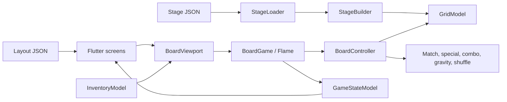

# Pho Logic

<div align="center">
  
  <p><strong>A Vietnamese-inspired match-3 student portfolio project built with Flutter and Flame.</strong></p>

  <p>
    <a href="https://play.google.com/store/apps/details?id=com.cuongtmodwork.phologic"><strong>Google Play</strong></a>
    &nbsp;|&nbsp;
    <a href="https://cuongme.github.io/pho_logic_mvp/">Support / privacy</a>
    &nbsp;|&nbsp;
    <a href="https://cuongme.github.io/pho_logic_mvp/documentation.html">Technical documentation</a>
    &nbsp;|&nbsp;
    <a href="https://cuongme.github.io/pho_logic_mvp/gdd.html">Game Design Document</a>
  </p>

  <p>
    
    
    
    
    
  </p>
</div>

> [!IMPORTANT]
> Pho Logic is a student portfolio project and learning-focused MVP. It demonstrates game-engine architecture, data-driven content, responsive Flutter UI, and mobile publishing workflows. It should not be read as a production-complete commercial game.


## Project Snapshot

Pho Logic is a tap-driven match-3 puzzle game themed around Vietnamese food and festival imagery. A valid turn swaps two adjacent tiles and creates a line match, a 2x2 special pattern, or activates a special tile. The board then resolves clears, visual effects, gravity, refill, cascades, and a solvability check before returning control to the player.

The checked-in campaign contains 25 JSON-authored stages on an 8x7 logical grid. Stages vary the playable board shape, move budget, collection targets, tile spawn weights, and late-game scooter blockers.

| Area | Implemented in this repository |
| --- | --- |
| Core play | Adjacent swaps, line matches, 2x2 patterns, cascades, gravity, refill, dead-board detection, and shuffle |
| Content | 25 stages, six regular tile types, five special tile types, shaped boards, and one blocker type |
| Objectives | One to three tile-collection targets; stages with scooters also require every blocker to be cleared |
| Presentation | Flame-rendered board, tile movement, particles, special VFX, blocker VFX, BGM, and SFX |
| App shell | Menu, world map, gameplay HUD, pause, help, settings, stage progress, win, lose, and no-move flows |
| Persistence | Inventory, stage results, language choice, and free-boost cooldown through `SharedPreferences` |
| Platforms | Flutter project wrappers for Android, iOS, web, Windows, macOS, and Linux |

## Gameplay Rules

1. Select a tile, then select an adjacent tile.
2. The swap is accepted if it creates a horizontal or vertical line match, creates a 2x2 block of one regular tile type, or includes a special tile.
3. Regular clears update collection objectives. A regular match next to a scooter can also break that blocker.
4. Gravity moves tiles through playable cells without crossing blockers; refill adds weighted regular tiles.
5. Cascades continue until the board stabilizes, with a safety limit of 10 resolution passes.
6. A stage is won when every collection target is complete and every initial scooter blocker is gone. It is lost when moves reach zero before that condition is met.

### Special Tiles

| ID | Special | Created by | Implemented effect |
| ---: | --- | --- | --- |
| `101` | Horizontal Party Popper | Four regular tiles in a horizontal line | Clears its playable row |
| `102` | Vertical Party Popper | Four regular tiles in a vertical line | Clears its playable column |
| `103` | Sticky Rice Bomb | Five regular tiles in a straight line | Clears all regular tiles matching the tile swapped with it |
| `104` | Firecracker | Intersecting horizontal and vertical matches with a union of 5 or 6 cells | Clears a playable 3x3 area centered on the special |
| `105` | Dragon Fly | A 2x2 block of one regular tile type | Clears the swap partner, the Dragon Fly, and one deterministic additional regular target |

Special-to-special swaps are handled separately by `SpecialComboResolver` as an ordered sequence of effects. See the [GDD](GDD.md#special-combinations) for the player-facing matrix and [architecture reference](ARCHITECTURE.md#special-resolution) for execution details.

| Party Popper | Sticky Rice Bomb |
| --- | --- |
|  |  |

| Firecracker | Dragon Fly |
| --- | --- |
|  |  |

## Architecture at a Glance

Flutter owns navigation, responsive screen composition, HUD state, dialogs, and inventory interactions. Flame owns the board scene and frame-timed visual effects. `BoardController` mutates the logical `GridModel`; `BoardGame` synchronizes those mutations to stable tile components identified by `tileInstanceId`.



The architecture is documented at three levels:

- [System architecture](ARCHITECTURE.md): boundaries, lifecycle, data flow, persistence, risks, and extension points.
- [Board engine guide](board_game.md): practical overview of the logical board and its collaborators.
- [Rendering reference](board_game_md.md) and [rule-engine reference](board_controller_md.md): focused notes for `BoardGame` and `BoardController`.

## Repository Map

```text
lib/
|-- main.dart                         App bootstrap and audio initialization
`-- src/
    |-- app/                          MaterialApp and named routes
    |-- audio/                        BGM and pooled SFX managers
    |-- game/
    |   |-- board/                    Rules, Flame board, specials, and board components
    |   |-- inventory/                Booster model and local persistence
    |   |-- model/                    Coordinates, cells, grid, and match records
    |   |-- progress/                 Per-stage latest-result persistence
    |   |-- stages/                   Stage schema, loader, builder, and validator
    |   `-- vfx/                      Special and blocker visual effects
    |-- screens/                      Menu, world, gameplay, settings, and dialogs
    |-- utils/                        JSON, logging, animation, and cooldown helpers
    `-- widgets/                      Reusable Flutter widgets

assets/
|-- json_design/                      1080x1920 screen-layout definitions
|-- stages/                           stage_001.json through stage_025.json
|-- sprites/                          Tile atlas, power-ups, blockers, and particles
|-- audio/                            BGM, SFX, and SFX tuning data
`-- backgrounds/, boards/, ui/        Screen and HUD artwork
```

## Run Locally

Prerequisites:

- Flutter SDK with a Dart SDK satisfying `>=3.0.0 <4.0.0`
- A configured Flutter target such as Android, Chrome, Windows, macOS, Linux, or iOS

```bash
flutter pub get
flutter run
```

Choose a target explicitly when needed:

```bash
flutter devices
flutter run -d chrome
```

Standard verification commands are:

```bash
flutter analyze
flutter test
```

> [!WARNING]
> The current `test/widget_test.dart` is still the default counter-app scaffold and references a `MyApp` class that this project does not define. Automated tests must be replaced before `flutter test` can serve as a release gate.

### Documentation Site

The GitHub Pages site is generated from `docs/` with Material for MkDocs. Use the pinned documentation environment and strict build locally:

```bash
python -m pip install -r requirements-docs.txt
python -m mkdocs serve
python -m mkdocs build --strict
```

The development server defaults to `http://127.0.0.1:8000/`; open `/documentation.html` for the technical site. Root `index.html` remains the hand-maintained Google Play support/privacy page. The other root documentation HTML files are generated snapshots for branch-root Pages compatibility; edit the Markdown and theme source instead of those snapshots.

## Data-Driven Content

The app keeps stage content and screen placement outside the rule engine:

- `assets/stages/stage_XXX.json` defines grid dimensions, weighted regular tiles, beds/voids, blocker markers, move limits, and collection objectives.
- `assets/json_design/*.json` defines a 1080x1920 design space for the menu, world map, gameplay HUD, and help content.
- `assets/audio/sfx_tuning.json` controls per-effect volume, cooldown, and playback delay. Pool sizes remain code-owned, and the accepted pitch argument is not currently applied by `AudioPool`.

This separation makes stage and presentation iteration possible without editing match logic. It does not remove the need for runtime validation or playtesting; see [Content Authoring](GDD.md#content-authoring) in the GDD.

## Student Project and Advertising Note

This repository documents a portfolio learning exercise, including a demo AdMob/app-publishing experiment. The root `app-ads.txt` is retained for that exercise. Advertising is not a design pillar, and the current `pubspec.yaml` does not declare the Google Mobile Ads Flutter package. The implemented booster reward path is a local prototype cooldown, not a production ad economy.

The project author sourced the demo background music from [Pixabay's royalty-free music library](https://pixabay.com/music/) for this student project. The repository does not currently retain the original track pages, creator names, download dates, or license certificates; those records should be restored and checked against the [Pixabay Content License](https://pixabay.com/service/license-summary/) before redistributing the audio or preparing another release.

## Current Engineering Status

- Version: `1.0.0+6`
- Campaign: 25 stage files and 25 generated gameplay routes
- State model: local-only persistence; no first-party account system or backend appears in the source
- Test coverage: not yet established
- Known navigation mismatch: the world map exposes stages 1-25, but the win dialog currently auto-advances only while the next stage is `<= 20`
- Stage validation exists as `StageValidator`, but the runtime load path does not currently invoke it

These constraints are recorded so the repository remains useful as an engineering case study rather than presenting prototype work as production-complete.

## Documentation

| Document | Purpose |
| --- | --- |
| [Support and privacy](https://cuongme.github.io/pho_logic_mvp/) | Google Play developer-site landing page, `app-ads.txt` link, and privacy policy |
| [Technical documentation](https://cuongme.github.io/pho_logic_mvp/documentation.html) | Browser-friendly system architecture and implementation tour |
| [Game Design Document](https://cuongme.github.io/pho_logic_mvp/gdd.html) | Rules, content model, progression, UX, balance framework, and production boundaries |
| [ARCHITECTURE.md](ARCHITECTURE.md) | Canonical repository-level engineering reference |
| [GDD.md](GDD.md) | Canonical repository-level game design blueprint |

## License

The repository includes the [GNU General Public License v3](LICENSE). GPL-3.0 permits use, modification, and redistribution under its terms; it is not a no-redistribution license. Media and audio assets may carry obligations separate from source-code licensing, so verify applicable rights before redistributing a packaged build.
