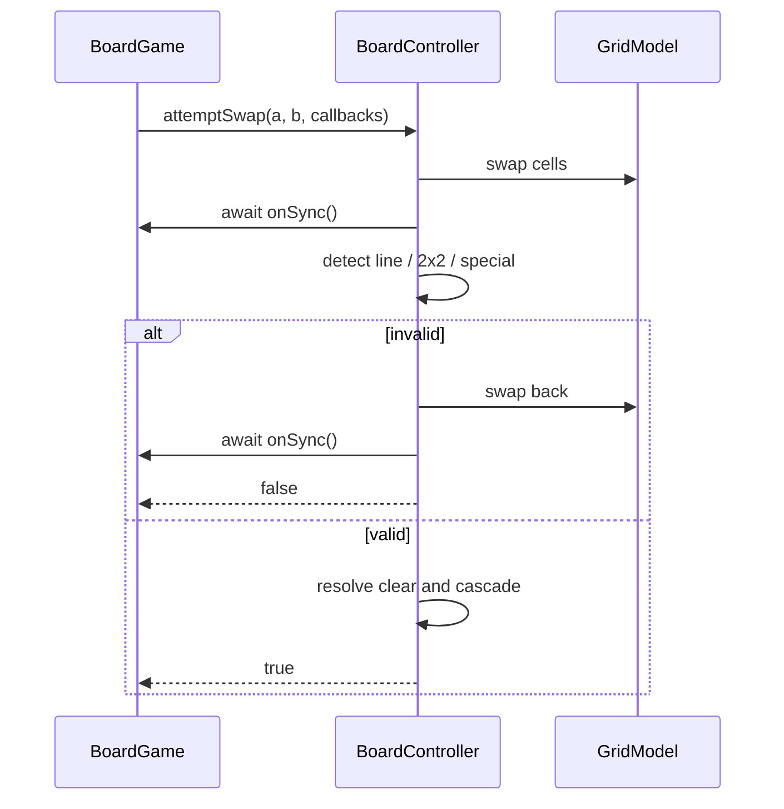

# BoardController Rule Engine Reference

> [!NOTE]
> Source: `lib/src/game/board/board_controller.dart`. This document describes the checked-in rule engine for the Pho Logic student portfolio project.

## Role

`BoardController` orchestrates one authoritative `GridModel`. It contains no Flutter widgets and no Flame components. Visual timing enters through awaited callbacks.

### Direct Collaborators

| Collaborator | Role |
| --- | --- |
| `GridModel` | Mutable board state |
| `StageData` | Tile definitions, weights, and stage rules |
| `SfxManager` | Rule-triggered sound effects |
| `SpecialTileSpawner` | Pattern-to-special creation |
| `SpecialActivationResolver` | Normal special activation |
| `SpecialComboResolver` | Ordered special-pair steps |
| `BoardSolvability` helpers | Legal-move checks and shuffle support |
| `WeightedPicker` | Regular refill selection |

### Public Behavior Surface

The important operations are:

- Initialize missing tile instance IDs.
- Stabilize an initial board.
- Check whether a swap is structurally allowed.
- Detect line matches.
- Attempt and resolve a player swap.
- Clear matched/special cells.
- Apply gravity and refill.
- Run cascades.
- Detect possible moves and shuffle.
- Place an inventory special at a coordinate.
- Register clear and blocker callbacks.

## Rule Invariants

1. A playable cell has `bedId != -1`.
2. A swappable cell is playable, has a tile, and has no blocker.
3. Only orthogonally adjacent cells can swap.
4. Specials are IDs `101..105`; normal line matching ignores them.
5. Refill selects only regular stage tiles.
6. A moving tile preserves its instance ID.
7. Every clear event captures regular victim types before cells are emptied.
8. Special-created spawn coordinates survive their creation clear.
9. A stable post-turn board should contain a legal move or a special.

## Initialization

### Instance IDs

`initializeInstanceIds()` assigns unique IDs to existing tiles that lack
them. These IDs are consumed by `BoardGame` and VFX, so later mutations must
move them with the tile value.

### Initial Stabilization

`stabilizeInitialBoard()` repeatedly detects initial line matches and rerolls
matched regular cells. It is a runtime defense when
`allowInitialMatches == false`.

Stage construction also has initial-match avoidance for unresolved weighted
cells. Because `StageLoader` normally resolves `0` entries first, initial
randomization currently has overlapping ownership.

## Swap Eligibility

`canSwap(a, b)` checks:

- Both coordinates are in bounds.
- Both cells are playable.
- Both contain tiles.
- Neither contains a blocker.
- The coordinates are orthogonally adjacent.

It does not by itself prove that the swap creates an accepted result.
`_willSwapBeValid()` simulates the exchanged tile types and accepts:

- A horizontal/vertical line created at either swapped coordinate.
- A same-type regular 2x2 around the swap.
- Any swap that includes a special tile.

## Swap Transaction



`BoardGame`, not the controller, decrements the move after a `true` result.
This keeps session-state ownership outside the board rule engine.

## Match Detection

`detectMatches()` scans each playable row and column for contiguous equal
regular tile IDs. It produces `Match` records and a union of all matched
coordinates.

The scan excludes:

- Void beds.
- Blocker cells.
- Empty cells.
- Special IDs `101..105`.

Horizontal and vertical runs can intersect. That overlap is retained so the
special spawner can recognize T/L unions.

## Special Creation

`SpecialTileSpawner.processMatches()` collects candidates, sorts by priority,
and greedily accepts non-overlapping cells:

| Priority | Pattern | Special |
| ---: | --- | --- |
| 5 | Exactly five straight | Sticky Rice `103` |
| 4 | Horizontal/vertical union of 5-6 | Firecracker `104` |
| 3 | Same-type 2x2 around the swap | Dragon Fly `105` |
| 2 | Exactly four horizontal | Party Popper `101` |
| 2 | Exactly four vertical | Party Popper `102` |

Spawn placement prefers `swapB`, then `swapA`, then a deterministic
pattern fallback. The accepted spawn cell is removed from `cellsToClear`
before mutation.

## Clear Pipeline

`clearMatchedCells()` coordinates:

1. Pattern processing and protected spawn coordinates.
2. Special-pair detection.
3. Normal special activation or combo-step construction.
4. Creation of special tile IDs at protected coordinates.
5. VFX-controlled and controller-controlled clear partitioning.
6. Victim capture and callbacks.
7. Blocker-break animation and final blocker removal.

The method captures tile types before setting `tileTypeId` and
`tileInstanceId` to null. Only regular victim IDs reach objective accounting.

### Blocker Damage

Regular clear calls use `isRegularClear: true`. Each such coordinate can mark
an adjacent scooter for a pending break. Special clear calls use
`isRegularClear: false` and do not damage adjacent scooters.

Pending breaks are deduplicated, animated through `onBlockerBreak`, removed
from the model, and reported through `onBlockerCleared`.

## Normal Special Activation

`SpecialActivationResolver` accepts swap coordinates and the first-selected
`chosenCoord`. It activates at most one source in the normal path:

- If one swapped tile is special, activate it.
- If both are special but combo routing is not used, activate the chosen
  coordinate.
- Specials inside the affected set clear without recursively activating.

| ID | Affected cells |
| ---: | --- |
| `101` | Playable row |
| `102` | Playable column |
| `103` | Regular tiles matching the regular swap partner, plus source |
| `104` | Playable centered 3x3 |
| `105` | Swap partner, source, and one deterministic additional target |

Metadata carries Sticky Rice activation cells and Dragon Fly target
coordinates to the VFX layer.

## Special Combinations

`SpecialComboResolver.resolveCombo()` returns:

- Whether both swap tiles form a combo.
- Activated and other source/type metadata.
- Ordered `ComboStep` records.
- A union of affected cells.

The controller executes steps sequentially in `_runComboSteps()`. Each step
can dispatch an independent VFX callback before logical cleanup.

Important non-obvious policies:

- `104 + 104` uses one 3x3 at the activated source.
- `104 + 101/102` uses the Firecracker 3x3 only.
- `103 + 103` clears all regular tiles.
- `105 + 105` selects up to two pre-hit targets.
- Sticky Rice mixed combos clear a selected regular type before the other
  line/3x3 step.
- Dragon Fly mixed combos pre-hit before the other effect.

See [GDD.md](GDD.md#special-combinations) for the complete pair matrix.

## Gravity

`applyGravity()` processes columns while treating voids and blockers as hard
boundaries. Within each playable segment, non-null tiles compact toward the
bottom. A tile's type and instance ID move together.

Example:

```text
Before        After
tile A        empty
empty         empty
tile B        tile A
blocker       blocker
empty         empty
tile C        tile C
```

The blocker prevents `tile B` from entering the lower segment.

## Refill

`refill()` visits empty playable, non-blocker cells and chooses from regular
stage tile definitions using the configured weights. It assigns a fresh
instance ID for every spawned tile.

Special IDs are excluded from refill. Stage 21 can pre-place specials as fixed
IDs, but their zero weights must not enter `WeightedPicker`.

## Cascade Loop

`runCascade()` has a default `maxCascades = 10`.

For each pass:

1. Detect line matches.
2. If no line exists, scan all same-type regular 2x2 blocks.
3. Clear and create specials.
4. Await render/VFX synchronization.
5. Apply gravity and synchronize.
6. Refill and synchronize.
7. Check solvability.
8. Repeat while a pattern remains.

Swap coordinates and `chosenCoord` are used only on the first pass. Automatic
cascades use deterministic fallback spawn positions.

The 10-pass cap protects against an accidental endless resolution loop. Hitting
it is logged and should be treated as a test failure in deterministic board
tests.

## Solvability and Shuffle

`hasPossibleMove()` uses the same validity categories as a real attempt:
line, 2x2, or special involvement.

`ensureSolvableOrShuffle()` returns immediately when:

- Any special exists, because swapping a special is accepted.
- At least one normal possible move exists.

Otherwise it shuffles regular tile assignments and searches for a board that:

- Meets the initial-match policy.
- Has a possible move.

The method invokes the no-moves callback so Flutter can show the temporary
shuffle modal.

## Inventory Placement

`placeSpecialAt(coord, powerTypeId)` validates:

- Coordinate bounds.
- Playable bed.
- No blocker.
- Existing regular tile.
- Power ID in `101..105`.

It changes the cell's type while retaining or assigning a tile instance ID.
Inventory availability is checked and spent outside this controller in
`BoardViewport`.

## Callback Contract

| Callback | Timing | Purpose |
| --- | --- | --- |
| `onSync` | After mutation boundaries | Let the renderer converge and animate |
| `onSpecialActivated` | Per normal activation or combo step | Play source-specific VFX with metadata |
| `onNoMovesDetected` | Before/around shuffle | Display temporary player feedback |
| `onCellsClearedWithTypes` | After victim capture | Particles and objectives |
| `onBlockerBreak` | Before blocker removal completes | Await scooter exit VFX |
| `onBlockerCleared` | After logical blocker clear | Update blocker win state |

Callbacks that control sequencing return `Future<void>` and are awaited.
Replacing them with fire-and-forget calls can make rendering and model state
diverge.

## Mutation Safety

When adding a rule:

1. Mutate the model, not Flame components.
2. Preserve identity when moving an existing tile.
3. Protect special spawn coordinates from clears.
4. Capture victim IDs before clearing.
5. Keep regular and special blocker-damage policy explicit.
6. Await VFX whose impact timing controls a clear.
7. Synchronize after each observable board phase.
8. End with a stable and solvable board.

## Complexity Notes

For an 8x7 board, straightforward scans are appropriate:

- Line detection is `O(rows * columns)`.
- 2x2 scanning is `O(rows * columns)`.
- Gravity and refill are `O(rows * columns)`.
- Possible-move search examines adjacent pairs and local simulated patterns.

The board is small, so clarity and correctness dominate micro-optimization.
The risk is asynchronous orchestration and state ownership, not raw scan cost.

No object-pooling claim should be made for controller data structures; normal
Dart collections and records are used.

## High-value Unit Tests

### Match Detection

- Runs of 3, 4, and 5 on both axes.
- Runs broken by void, blocker, empty cell, or special.
- Intersecting T/L matches.
- Overlapping matches without duplicate victim accounting.

### Special Creation

- Every pattern maps to the correct ID.
- `swapB`, `swapA`, and fallback spawn location.
- Priority and overlap rejection.
- Spawn cell excluded from victim set.
- Automatic cascade 2x2 detection.

### Activation and Combos

- Each normal affected-cell set at edges, voids, and blockers.
- Sticky Rice with valid and invalid swap partner.
- Dragon Fly deterministic target and fallback.
- All special-pair combinations and step order.
- Specials in another effect clear without recursive VFX.

### Board Physics

- Gravity through irregular void patterns.
- Blocker-separated segments.
- Instance IDs move with tiles.
- Refill never creates specials.
- Stable board has no accidental matches when required.
- Dead board shuffles to a legal board.

### Events

- One clear callback per logical victim batch.
- Special IDs excluded from objectives.
- Adjacent regular clear breaks each scooter once.
- Special clear does not break scooters under current policy.
- Blocker VFX callback precedes blocker-cleared notification.

Use seeded `Random` values for all random-dependent tests. Some controller
randomness is currently created internally; injecting it through construction
would improve reproducibility.

## Known Technical Debt

- StageLoader and StageBuilder duplicate weighted initialization.
- StageValidator is not invoked by the runtime load path.
- Zero-weight fixed specials in stage 21 conflict with the validator's blanket
  positive-weight rule.
- BoardController is large and owns several phases; extracting transaction
  phase objects should be considered only alongside tests.
- Special and regular clear paths intentionally differ for blockers and require
  an explicit design decision.

Related references:

- [Board engine guide](board_game.md)
- [BoardGame rendering](board_game_md.md)
- [System architecture](ARCHITECTURE.md)
