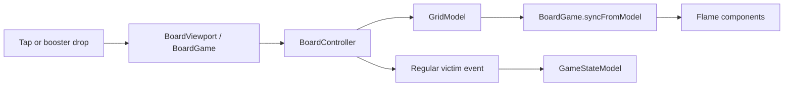
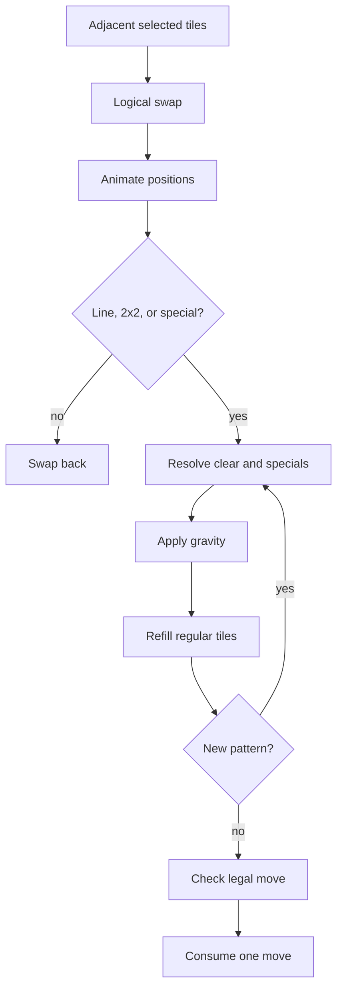

# Pho Logic Board Engine Guide

> [!NOTE]
> This guide describes the implemented board engine in Pho Logic version `1.0.0+6`. Pho Logic is a student portfolio project. For system-wide boundaries, see [ARCHITECTURE.md](ARCHITECTURE.md); for player-facing rules, see [GDD.md](GDD.md).

## Purpose

The board engine is split so that game truth, orchestration, presentation, and screen state do not share ownership:

| Part | Responsibility |
| --- | --- |
| `GridModel` | Authoritative cells, tile IDs, instance IDs, beds, and blockers |
| `BoardController` | Swaps, matches, special rules, clearing, gravity, refill, and shuffle |
| `BoardGame` | Flame components, tap handling, model synchronization, particles, and VFX |
| `BoardViewport` | Flutter/Flame embedding and booster drop conversion |
| `GameStateModel` | Moves, objectives, blockers, win, and loss |

## Core Data

### Coord

`Coord(row, col)` is the logical position type. It is immutable and supports equality, hashing, and orthogonal-adjacency checks. It is used in maps and sets throughout rules and rendering.

### Cell

A cell can contain:

- `tileTypeId`: regular `1..6`, special `101..105`, or `null`.
- `tileInstanceId`: stable identity while a tile moves.
- `bedId`: `-1` for void or a playable bed ID.
- blocker state, currently the scooter blocker.

### Invariants

1. `GridModel` is the source of truth.
2. Void cells never swap, match, refill, or receive effects.
3. Blockers reject swaps and divide gravity into segments.
4. Refill creates regular IDs only.
5. Moving tiles preserve their instance IDs.
6. Newly spawned tiles receive new instance IDs.

## Session Initialization

1. `StageLoader` parses a stage asset and resolves weighted `0` entries.
2. `StageBuilder` converts the matrices to `BoardState`.
3. `GridModel.fromBoardState()` creates the cell matrix.
4. `BoardGame` builds regular and special tile-definition lookup maps.
5. `BoardController.initializeInstanceIds()` fills missing tile identities.
6. `BoardController.stabilizeInitialBoard()` removes accidental starting matches.
7. `BoardGame.onLoad()` creates beds, blockers, and tile components.

The stage's `grid.shape.mask` is not consumed by current board construction; `bedMap` determines playable cells.

## Turn Flow

An invalid swap returns without spending a move. `BoardGame` holds a busy flag for the complete asynchronous transaction, preventing a second input from interleaving with model mutation or VFX.

## Match and Special Rules

Line detection accepts horizontal and vertical runs of at least three equal regular IDs. The engine also treats a same-type regular 2x2 as a valid pattern.

| Pattern | Result |
| --- | --- |
| Three or more in a line | Clear regular victims |
| Exactly four horizontal | Spawn ID `101`, horizontal Party Popper |
| Exactly four vertical | Spawn ID `102`, vertical Party Popper |
| Exactly five straight | Spawn ID `103`, Sticky Rice Bomb |
| Intersecting runs with union 5-6 | Spawn ID `104`, Firecracker |
| Same-type 2x2 | Spawn ID `105`, Dragon Fly |

When creation candidates overlap, the spawner processes Sticky Rice, Firecracker, Dragon Fly, then Party Popper, accepting only non-overlapping patterns.

Normal activation and special-to-special combination are separate policies. A special encountered within another special's clear is removed without recursively activating another VFX.

## Blockers, Gravity, and Refill

A scooter blocker occupies a cell without a tile. It:

- Cannot be swapped.
- Stops a falling tile from crossing its row.
- Breaks when an adjacent regular match clears.
- Does not currently break from an adjacent special clear.
- Counts toward the stage win condition.

Gravity compacts each column inside playable, blocker-separated segments. Refill then creates weighted regular tiles in empty playable cells. Specials never appear from normal refill.

## Rendering Synchronization

Coordinates identify places, not moving objects. The renderer therefore tracks three tile registries:

| Map | Question answered |
| --- | --- |
| `tilesByInstanceId` | Which component renders this tile? |
| `instanceAtCoord` | Which tile is now at this cell? |
| `coordByInstanceId` | Where is this tile now? |

`syncFromModel()` creates replacement coordinate maps, animates existing components to model positions, changes sprites when a type changes, adds missing components, removes orphans, and swaps the maps atomically. `validateBoardSync()` performs a defensive repair pass.

For detailed rendering behavior, see [board_game_md.md](board_game_md.md).

## State Events

The controller captures regular tile types before clearing. `BoardGame` receives that map and:

1. Spawns object-specific particles unless a VFX owns the impact.
2. Forwards regular victims to `GameStateModel`.

`GameStateModel` clamps objective progress to target counts. It also tracks initial and remaining blocker counts. A valid swap consumes one move only after the complete resolution transaction succeeds.

## Booster Placement

`BoardViewport` converts the drop position from screen pixels to a logical coordinate. A target must be playable and contain a regular tile. `placeSpecialAt()` changes the tile type while preserving identity, then inventory spending is attempted.

> [!WARNING]
> Placement and spending are not atomic. A failed spend logs an error but does not restore the original regular tile.

## Solvability

The possible-move check uses the same acceptance criteria as a player action: line, 2x2, or special involvement. A stable board shuffles only when:

- No special exists.
- No possible move exists.

The shuffle seeks a board with no unintended starting match when required and at least one legal move.

## Debugging Checklist

When a board/render discrepancy appears:

1. Inspect the `GridModel` cell values first.
2. Confirm every non-null tile has a unique `tileInstanceId`.
3. Compare `instanceAtCoord` with model instance IDs.
4. Confirm `coordByInstanceId` is the inverse mapping.
5. Run or inspect `validateBoardSync()` diagnostics.
6. Check whether VFX cleared cells directly before the standard controller phase.
7. Verify that the busy flag was held across the full transaction.

When an objective discrepancy appears:

1. Confirm victim IDs were captured before clearing.
2. Confirm specials were filtered and regular IDs retained.
3. Confirm VFX-controlled clears call the shared clear path.
4. Check that scooter changes use the blocker callback, not tile objectives.

## Extension Rules

Any new board feature should preserve:

- Model-first mutation.
- Stable identity for moving tiles.
- Explicit VFX/logical timing.
- One owner for objective events.
- Blocker and void filtering.
- Seedable randomness for tests.
- A stable, solvable post-turn board.

The next documents provide focused implementation references:

- [BoardGame rendering](board_game_md.md)
- [BoardController rules](board_controller_md.md)
