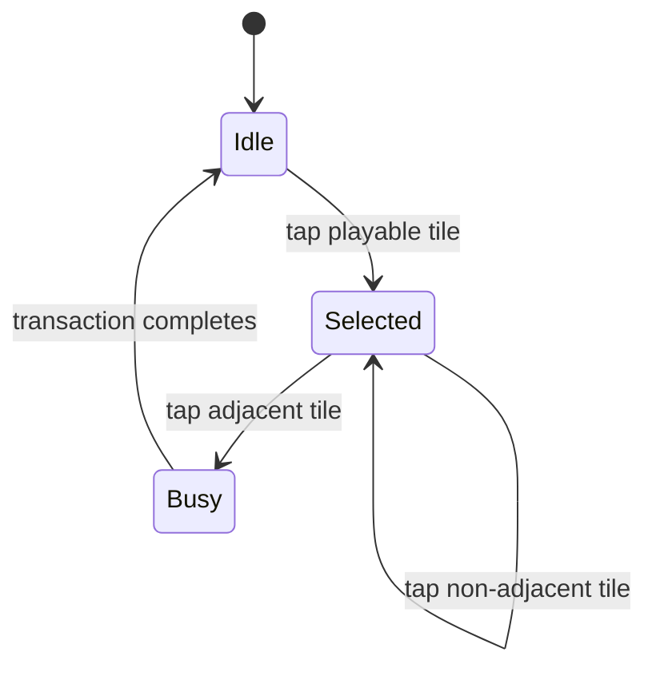

# BoardGame Rendering Reference

> [!NOTE]
> Source: `lib/src/game/board/board_game.dart`. This reference describes the checked-in implementation for the Pho Logic student portfolio project.

## Role

`BoardGame` is the Flame adapter around an authoritative `GridModel`. It owns visual components and interaction sequencing, but delegates match-3 policy to `BoardController`.

| Owns | Delegates |
| --- | --- |
| Fixed-resolution camera and board geometry | Swap validity and logical mutation |
| Bed, tile, and blocker components | Match and special creation |
| Tap selection and input lock | Gravity, refill, cascade, and shuffle |
| Model-to-component synchronization | Affected-cell computation |
| Particle and special VFX dispatch | Objective policy |
| Clear/blocker callback wiring | Persistence |

## Construction

The constructor receives rows, columns, the grid/stage models, and the Flutter viewport dimensions. It configures a fixed-resolution camera and computes:

```text
tileSize = min(viewportWidth / columns, viewportHeight / rows)
gridLeft = (viewportWidth  - tileSize * columns) / 2
gridTop  = (viewportHeight - tileSize * rows) / 2
```

This centers the complete logical grid inside `BoardViewport`.

The constructor builds lookup maps for stage beds and regular tiles, then registers special IDs that are not required in normal stage definitions:

| ID | Asset |
| ---: | --- |
| `101` | Horizontal Party Popper |
| `102` | Vertical Party Popper |
| `103` | Sticky Rice Bomb |
| `104` | Firecracker |
| `105` | Dragon Fly |

It constructs `BoardController`, injects `SfxManager.instance`, assigns missing tile instance IDs, stabilizes the initial board, and installs clear/blocker callbacks.

## Component Registries

`BoardGame` keeps identity and coordinate lookups separate:

```dart
final Map<int, TileComponent> tilesByInstanceId = {};
final Map<Coord, int> instanceAtCoord = {};
final Map<int, Coord> coordByInstanceId = {};
final Map<Coord, BedComponent> bedComponents = {};
final Map<Coord, BlockerComponent> blockerComponents = {};
```

### Registry Invariants

For every model cell with a tile:

1. `tileInstanceId` is non-null.
2. `tilesByInstanceId[id]` exists.
3. `instanceAtCoord[coord] == id`.
4. `coordByInstanceId[id] == coord`.

For every tile component, exactly one model cell should carry its instance ID.

These maps allow a tile to move from coordinate A to B without destroying and recreating its component.

## Coordinate Conversion

`coordToWorld()` maps a logical cell to the component center. `worldToCoord()` performs the inverse using the centered grid origin and tile size, then rejects values outside rows/columns or non-playable cells.

`BoardViewport` contains equivalent screen-to-board math for drag/drop boosters because the drag event originates in Flutter screen coordinates rather than Flame world coordinates.

## Load Lifecycle

`onLoad()` loads the tile atlas and particle sprites, creates bed components
for playable cells, creates blocker components where the model has blockers,
and creates/registers tile components for every current tile.

The game background is transparent because Flutter renders the gameplay
background and board frame around the Flame viewport.

## Input State

The tap interaction has two local states:

- No selected tile: select the tapped playable tile.
- Selected tile: attempt an adjacent swap or move selection.

`_isBusy` guards the complete asynchronous transaction. It is set before
`controller.attemptSwap()` and cleared in `finally`, ensuring exceptions do
not permanently lock input.



Selection and booster hover reuse a component highlight, but drag hover does
not replace the active swap-selection highlight.

## Controller Callbacks

### Clear Callback

`setOnCellsClearedWithTypes()` receives regular victims captured before model
clearing. The callback:

1. Filters coordinates whose VFX already owns the impact burst.
2. Spawns object-specific particles for remaining victims.
3. Removes used suppression markers.
4. Forwards the map to `GameStateModel.processClearedTiles()`.

An empty map is still safe to forward.

### Blocker Callbacks

`setOnBlockerBreak()` awaits `BlockerBreakVfx.play()` against the registered
component. `setOnBlockerCleared()` decrements the remaining blocker count in
`GameStateModel`.

### Special Callback

The controller reports activated specials by coordinate plus effect metadata.
Before dispatching VFX, `BoardGame`:

1. Reads the current instance ID from `GridModel`.
2. Confirms the component exists.
3. Converts coordinate-keyed activation data to instance-keyed data.
4. Converts target/affected-cell metadata.
5. Awaits `SpecialVfxDispatcher.playSpecialVfx()`.

Instance IDs protect VFX source lookup when coordinates move during a combo.

## Swap Orchestration

`_processSwap(a, b)` calls `BoardController.attemptSwap()` with:

- `chosenCoord = a`, the first selected tile.
- `onSync`, which awaits `syncFromModel()` then `validateBoardSync()`.
- `onNoMovesDetected`, forwarded from the Flutter gameplay screen.
- `onSpecialActivated`, which dispatches the current VFX invocation
  immediately.

If the controller returns `true`, `GameStateModel.decrementMoves()` runs
once. Invalid swaps do not spend a move.

Combo steps call the special callback independently. The renderer must not
accumulate them into one later batch because ordering is part of combo
behavior.

## Model Synchronization

`syncFromModel()` is the critical rendering algorithm:

1. Snapshot every model coordinate and instance ID.
2. Build new `instanceAtCoord` and `coordByInstanceId` maps.
3. For each model tile, find or create its component by instance ID.
4. Update sprite/type if the logical type changed.
5. Animate an existing component from its old position to its new world
   position.
6. Remove components whose IDs are absent from the model snapshot.
7. Replace coordinate maps with the new maps.
8. Synchronize blocker components.

Map replacement occurs after the snapshot is built so lookup users do not
observe a partially migrated board.

## Defensive Validation

`validateBoardSync()` checks:

- Every model tile has an instance ID.
- A component exists for that ID.
- Its tile type agrees with the model.
- Its registration maps agree with the model coordinate.
- No registered component is orphaned.

It can recreate missing components, update mismatched sprites, and remove
orphans. Treat a repair as evidence of an upstream invariant violation;
diagnostics should identify the mutation path rather than relying permanently
on repair.

## Particle Strategy

Particle sprite mappings are loaded by regular tile ID. The generic clear
callback uses those mappings to make food-specific debris. A clear larger than
eight victims uses reduced particle complexity to limit visual and allocation
pressure.

Three sets coordinate special timing:

| Set | Purpose |
| --- | --- |
| Dragon Fly targets | Marks coordinates receiving Dragon Fly treatment |
| Special-clear coordinates | Marks cells cleared by special logic |
| Suppressed auto bursts | Prevents duplicate generic particles when a VFX emits impact particles |

Markers must be removed when the effect completes or the affected cells clear.

## Direct VFX Clears

`clearTilesAtCoords()` is available to VFX whose visual impact defines the
correct clear time, notably Party Popper projectiles and Firecracker. It routes
through the controller's clear/event behavior rather than mutating components
alone.

VFX should never delete a `TileComponent` as the sole state change. Logical
model mutation must remain authoritative, followed by synchronization.

## Blocker Synchronization

`_syncBlockersFromModel()` compares blocker model state with
`blockerComponents`:

- Add a component when a model blocker has no visual.
- Keep the registered component while the blocker exists.
- Remove a component when no blocker remains.

The break animation runs through the controller callback before final
component cleanup.

## Change Checklist

Before adding a rendering feature:

1. Identify the authoritative model field.
2. Decide whether the feature follows a tile identity or a coordinate.
3. Preserve instance IDs across moves.
4. Add any temporary marker with an explicit cleanup path.
5. Route logical clearing through the controller.
6. Await VFX that controls rule timing.
7. Run synchronization after mutation boundaries.
8. Confirm component registries remain bijective.
9. Verify input stays locked for the complete transaction.
10. Test void, edge, blocker, special, and combo cases.

## Common Failure Modes

| Symptom | Likely cause |
| --- | --- |
| Wrong tile animates | Coordinate used as identity instead of instance ID |
| Duplicate tile sprite | Old component not removed or instance ID duplicated |
| Objective misses a VFX clear | Direct visual removal bypassed controller clear event |
| Double particle burst | Suppression marker missing or removed too early |
| Tap accepted during cascade | Busy guard released before controller returns |
| Blocker visual remains | Model clear did not reach blocker synchronization |
| VFX source disappears early | Logical clear occurred before source animation captured its component |

## Recommended Tests

- Construct a small grid and assert coordinate/world round trips.
- Move multiple instance IDs in one sync and verify registry inverses.
- Change a tile from regular to special while preserving its component.
- Remove/refill a tile and verify old/new instance ownership.
- Clear through each VFX path and assert one objective event.
- Break a blocker and verify callback order and component cleanup.
- Force an exception during a swap and verify the busy flag releases.

Related references:

- [Board engine guide](board_game.md)
- [BoardController rule engine](board_controller_md.md)
- [System architecture](ARCHITECTURE.md)
