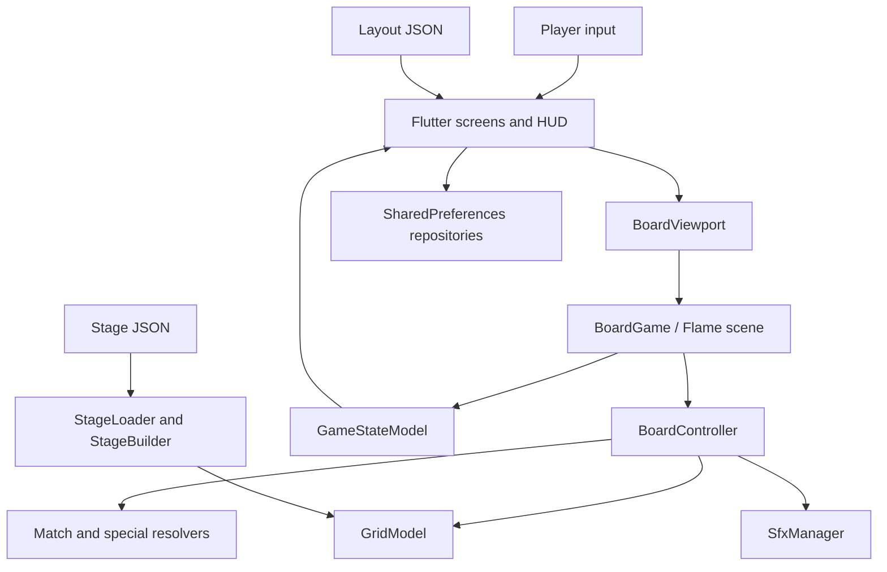
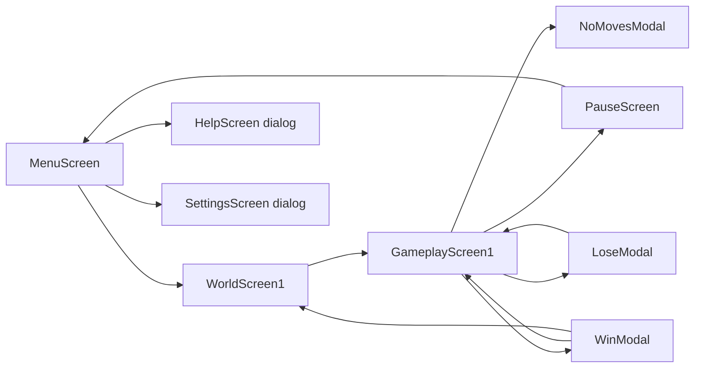
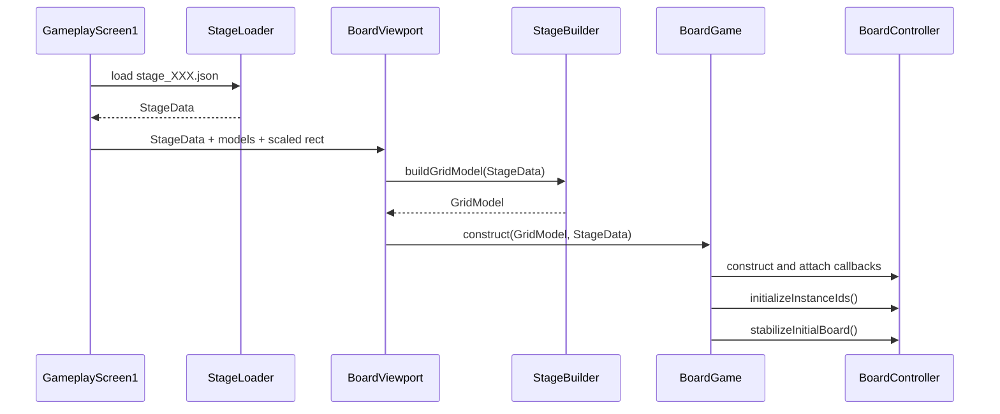
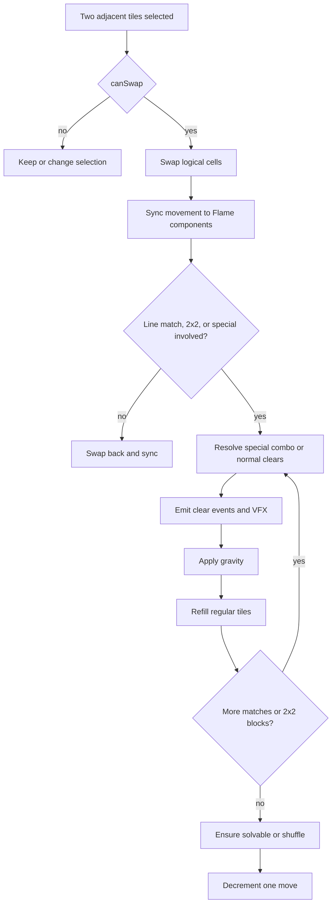
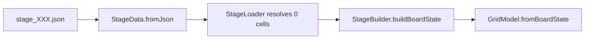

# Pho Logic Architecture

!!! important "Student portfolio scope"

    Pho Logic is a student portfolio project and learning-focused MVP. This
    document describes the code currently checked into the repository. It does
    not claim commercial readiness, production scale, or systems that are not
    present in source.

| Document field | Value |
| --- | --- |
| Application version | `1.0.0+6` from `pubspec.yaml` |
| Campaign content | 25 stage files, `stage_001.json` through `stage_025.json` |
| Primary language | Dart, SDK constraint `>=3.0.0 <4.0.0` |
| UI framework | Flutter |
| Board engine | Flame `^1.22.1` |
| Persistence | `shared_preferences` |
| Last code review for this document | 2026-08-12 |

## Scope and Sources of Truth

The architecture is derived from:

1. Runtime code under `lib/`.
2. Package and asset declarations in `pubspec.yaml`.
3. UI definitions under `assets/json_design/`.
4. Stage data under `assets/stages/`.

The [Game Design Document](gdd.md) is the source for player-facing rules and content intent. The focused [board guide](board-game.md), [BoardGame reference](board-game-rendering.md), and [BoardController reference](board-controller.md) expand on the core board modules.

Statements labelled **Current** describe implemented behavior. Statements labelled **Recommended** are engineering follow-up work and are not implemented features.

## System Context

Pho Logic uses Flutter as the application shell and Flame as an embedded board renderer. The logical board remains a Dart model. Flame components are projections of that model, not the source of game truth.



### Responsibility Boundaries

| Boundary | Owns | Does not own |
| --- | --- | --- |
| Flutter screens | Navigation, layout scaling, HUD, dialogs, inventory drag/drop, and screen lifecycle | Match detection or board mutation |
| `BoardViewport` | Embedding `GameWidget`, constructing a board session, coordinate conversion for booster drops | Match rules |
| `BoardGame` | Flame components, input lock, model-to-component synchronization, particles, and VFX dispatch | Authoritative tile placement rules |
| `BoardController` | Swaps, matches, special resolution, clear ordering, gravity, refill, solvability, and shuffle | Flutter navigation or HUD composition |
| `GridModel` | Authoritative cells, tile type IDs, stable instance IDs, beds, and blockers | Animation |
| State models | Moves, objectives, blockers, inventory counts, and change notifications | Board rendering |
| Repositories/managers | Local persistence and audio playback | Gameplay policy |

## Repository Organization

```text
lib/
|-- main.dart
`-- src/
    |-- app/                 Application root and route table
    |-- audio/               BGM and pooled SFX
    |-- game/
    |   |-- board/           Rule engine, Flame board, components, and special resolvers
    |   |-- inventory/       Booster state and persistence
    |   |-- model/           Coord, Cell, GridModel, Match, and BoardState
    |   |-- progress/        Latest per-stage result
    |   |-- stages/          Stage schema, load/build pipeline, and validator
    |   |-- utils/           Weighted picker and game logging
    |   `-- vfx/             Special and blocker effects
    |-- screens/             Menu, world map, gameplay, help, settings, and dialogs
    |-- utils/               App logging, JSON helpers, animations, and boost cooldown
    `-- widgets/             Reusable Flutter widgets
```

## Startup and Navigation

### Bootstrap

`main.dart` performs the following sequence:

1. Initializes Flutter bindings.
2. Locks orientation on native mobile targets.
3. Initializes `SfxManager` and `BgmManager`.
4. Runs `PhoLogicApp`.

`PhoLogicApp` creates the `MaterialApp`, supplies the global `navigatorKey`, and listens for pointer input so web audio can retry after a browser autoplay rejection.

No AdMob SDK is initialized by the current source, and `pubspec.yaml` does not declare `google_mobile_ads`. The root `app-ads.txt` belongs to a demo publishing exercise for this student project.

### Route Surface

`Routes.getRoutes()` registers:

- `/menu`
- `/world/1`
- `/gameplay/1` through `/gameplay/25`, generated in a loop



The world map displays five lanterns per page across five pages, covering stages 1-25. Stage progress records the latest terminal result, `cleared` or `lose`, in local preferences.

## Gameplay Session Construction

`GameplayScreen1` loads two independent resources:

- `assets/json_design/gameplay_1.json` for the screen composition and board rectangle.
- `assets/stages/stage_XXX.json` for stage rules and content.

The screen creates `InventoryModel` and `GameStateModel`, then supplies them to `BoardViewport`. The viewport builds a `GridModel` through `StageBuilder`, constructs `BoardGame`, and connects no-move and game-state callbacks.



The board is rebuilt when the viewport dimensions, row/column count, or `StageData` identity changes.

## Turn Transaction

The input path is tap based: the first tile is selected and the next adjacent tile becomes the swap candidate. `BoardGame._isBusy` prevents concurrent transactions.



A move is consumed only when `BoardController.attemptSwap()` returns success. The decrement occurs in `BoardGame` after the complete asynchronous resolution returns.

## Domain Model and Invariants

### Coordinates and Cells

`Coord` is an immutable logical `row` and `col` pair. It is used as a map/set key throughout board logic and rendering.

Each `Cell` can contain:

- `tileTypeId`: regular tile `1..6`, special `101..105`, or `null`.
- `tileInstanceId`: stable identity for the tile object during movement.
- `bedId`: `-1` for a void, otherwise a playable bed.
- blocker state, currently `BlockerType.scooterTileBlocker`.

Important invariants:

1. `GridModel` is authoritative. Flame components must converge to it after each sync.
2. A void cell has `bedId == -1` and must not participate in swaps, matches, gravity, or effects.
3. A blocker cell is not swappable and acts as a gravity barrier.
4. Regular spawn/refill IDs come from stage tile definitions; specials are not refilled randomly.
5. A tile keeps its `tileInstanceId` while moving so animation lookup remains stable.

### Board State Conversion

`StageBuilder` converts stage matrices into a `BoardState`, and `GridModel.fromBoardState()` creates the cell matrix. The tile-map sentinels are:

| Value | Meaning |
| ---: | --- |
| `0` | Weighted regular-tile spawn |
| `-1` | No tile / void |
| `-2` | Scooter blocker occupying the cell without a tile |
| `>= 1` | Fixed tile type ID |

At runtime, `bedMap` determines whether a cell is playable. The `grid.shape.mask` entries in stage JSON are descriptive metadata in the current implementation; board construction does not consume the mask.

## Match and Cascade Engine

`BoardController.detectMatches()` scans horizontal and vertical runs. It excludes void cells, blocker cells, missing tiles, and special IDs `101..105`.

A swap is valid when at least one of these conditions is true after simulation:

- A horizontal or vertical line match exists.
- A same-type regular 2x2 block exists around the swap.
- Either swapped tile is a special.

`runCascade()` repeatedly:

1. Detects line matches.
2. If no line match exists, scans for all 2x2 regular blocks.
3. Resolves clears and special creation.
4. Applies gravity.
5. Refills empty playable cells.
6. Synchronizes rendering.
7. Checks solvability.

The loop is capped at 10 passes. On a stable board, `ensureSolvableOrShuffle()` shuffles only when no special tile exists and no valid move can be found.

### Gravity and Refill

Gravity processes each column while respecting voids and blockers. A blocker divides a column into independent vertical segments; tiles do not move through it. Refill fills empty playable cells with weighted regular IDs from the stage definition.

Initial board handling has two defenses against accidental matches:

- `StageBuilder` can avoid creating a horizontal/vertical run while selecting unresolved weighted cells when `allowInitialMatches` is false.
- `BoardController.stabilizeInitialBoard()` rerolls detected initial matches.

The current load path normally resolves `0` cells in `StageLoader` before `StageBuilder`, so responsibility for weighted initialization is duplicated. This is tracked as technical debt below.

### Clear Accounting

`BoardController` captures tile types before mutating cells and sends a `Map<Coord, int>` through `setOnCellsClearedWithTypes`. `BoardGame` uses the event for particles and forwards it to `GameStateModel.processClearedTiles()`.

Only regular victim IDs are forwarded for collection progress. Special IDs are filtered out. Progress is clamped to each objective target.

Scooter blockers are cleared by adjacency to regular match clears. Special-clear paths call the clear emitter with `isRegularClear: false`, so special effects do not currently damage adjacent scooters.

## Special Resolution

### Creation

`SpecialTileSpawner` gathers every candidate, sorts by priority, and greedily accepts non-overlapping patterns.

| Priority | Pattern | Spawned ID | Spawned special |
| ---: | --- | ---: | --- |
| 5 | Exactly five regular tiles in a straight line | `103` | Sticky Rice Bomb |
| 4 | Intersecting horizontal and vertical runs with a union of 5 or 6 cells | `104` | Firecracker |
| 3 | Same-type regular 2x2 containing a swapped coordinate | `105` | Dragon Fly |
| 2 | Exactly four regular tiles in a horizontal line | `101` | Horizontal Party Popper |
| 2 | Exactly four regular tiles in a vertical line | `102` | Vertical Party Popper |

For a straight line, spawn placement prefers `swapB`, then `swapA`, then the center. T/L placement prefers `swapB`, then `swapA`, then the intersection. A 2x2 uses `swapB`, then `swapA`, then the top-left coordinate.

Spawn coordinates are removed from the clear set before mutation, preserving the newly created special.

### Single-Special Activation

`SpecialActivationResolver` activates a special involved in the swap. If both swapped cells are special in the normal activation path, the chosen/first-selected coordinate wins; actual special-to-special combinations are routed to `SpecialComboResolver`.

| ID | Affected cells |
| ---: | --- |
| `101` | Every playable cell in the special's row |
| `102` | Every playable cell in the special's column |
| `103` | Every playable regular tile whose type matches the regular tile swapped with it, plus itself |
| `104` | Playable cells in the centered 3x3 neighborhood |
| `105` | The swap partner, itself, and one deterministic additional matching regular tile; falls back to the first playable regular tile |

A special encountered inside another special's affected set is cleared without triggering another VFX activation. This is an intentional overlap-control rule in the current implementation, not a general chain-reaction system.

### Special Combinations

`SpecialComboResolver` produces ordered `ComboStep` records. The controller executes each step and coordinates VFX timing.

| Pair | Implemented sequence |
| --- | --- |
| `101 + 101` | Clear the two horizontal rows |
| `102 + 102` | Clear the two vertical columns |
| `101 + 102` | Clear one row and one column; order depends on swap orientation |
| `104 + 104` | One 3x3 clear centered on the activated coordinate |
| `103 + 103` | Clear all regular tiles |
| `105 + 105` | Up to two Dragon Fly pre-hit targets, depending on available regular tiles |
| `104 + 101/102` | Firecracker 3x3 step only |
| `103 + 101/102/104` | Clear all of a selected regular type, then run the other special's row, column, or 3x3 step |
| `105 + 101/102/104` | Dragon Fly pre-hit, then run the other special's row, column, or 3x3 step |
| `105 + 103` | Dragon Fly pre-hit, then clear the pre-hit regular tile type when available |

Random selection is injected through `Random` in the combo resolver, while Dragon Fly's normal same-type target search is deterministic by row and column order.

### VFX Timing

`SpecialVfxDispatcher` delegates to:

- `PartyPopperVfx`
- `FirecrackerVfx`
- `StickyRiceVfx`
- `StickyRiceDuoVfx`
- `DragonFlyVfx`

Party Popper and Firecracker effects own exact impact timing and call `BoardGame.clearTilesAtCoords()`. Sticky Rice and Dragon Fly communicate target metadata, animate first, and then allow the controller's clear path to complete. Suppression sets avoid duplicate particle bursts where a VFX already emits them.

## Rendering and Synchronization

`BoardGame` extends `FlameGame` with `TapCallbacks`. It uses a fixed-resolution camera sized to the Flutter viewport. Tile size is the smaller of viewport width per column and viewport height per row, then the complete grid is centered.

### Registries

The rendering layer maintains:

| Registry | Purpose |
| --- | --- |
| `tilesByInstanceId` | Stable tile identity to `TileComponent` |
| `instanceAtCoord` | Logical coordinate to current instance ID |
| `coordByInstanceId` | Instance ID to logical coordinate |
| `bedComponents` | Static bed component by coordinate |
| `blockerComponents` | Blocker component by coordinate |

`syncFromModel()` snapshots the model, constructs replacement coordinate maps, animates components whose instance IDs moved, updates changed sprites, creates missing components, removes orphaned components, and then swaps the coordinate maps. The maps are replaced as a unit so readers do not observe a half-updated mapping.

`validateBoardSync()` is a repair pass. It recreates missing/mismatched components and removes components that no longer correspond to model instances.

### Why Stable Instance IDs Matter

Coordinates describe locations, not tile identity. During a swap or gravity pass, multiple tiles change coordinates at once. Looking up components only by coordinate can animate the wrong sprite after the logical mutation. `tileInstanceId` lets the renderer ask, "Where did this tile move?" and animate that existing component to the new coordinate.

When adding a board mutation:

1. Preserve the moving tile's existing instance ID.
2. Assign a new instance ID only to a newly spawned tile.
3. Mutate `GridModel` before requesting a render sync.
4. Let `syncFromModel()` update coordinate registries.
5. Do not modify Flame registry maps from rule-engine code.

## Stage Pipeline

### Parse, Resolve, Build



`StageData` parses rows, columns, regular tile definitions, bed types, blocker definitions, tile and bed matrices, move count, objectives, and `allowInitialMatches`.

`StageLoader.loadFromAsset()`:

1. Reads and decodes the asset.
2. Creates `StageData`.
3. Builds a weighted picker from regular tile weights.
4. Normalizes void beds to tile value `-1`.
5. Mutates each `0` tile entry into a weighted regular ID.

`StageBuilder` then converts the data into matrices. It still supports unresolved `0` entries and avoids simple initial runs when doing so. It converts `-2` to an empty tile cell plus blocker marker.

### Validation

`StageValidator.validate()` checks:

- Positive dimensions.
- Tile and bed matrix dimensions.
- Tile definitions for weighted cells.
- References to known fixed tile IDs.
- Positive regular tile weights.
- References to known positive bed IDs.

**Current:** the gameplay load path does not call `StageValidator`. Invalid content can therefore fail later during build or rendering.

**Recommended:** validate immediately after parsing, fail with the stage path and aggregated validation messages, and add a test that loads every `assets/stages/stage_*.json` file.

## Responsive UI Architecture

Menu, world, and gameplay layouts use a 1080x1920 design space from JSON. Each screen computes:

```text
scale = min(usableWidth / designWidth, usableHeight / designHeight)
```

The scaled design is centered inside safe-area bounds. On web, scale is capped at `1.0`. Elements use design coordinates and size metadata; gameplay additionally converts `gridRect` into the Flutter pixel rectangle used by `BoardViewport`.

This is contain scaling. It preserves composition and aspect ratio but can leave unused space on screens whose aspect ratio differs significantly from 9:16.

## State and Persistence

### Game State

`GameStateModel` is session local and extends `ChangeNotifier`. It owns:

- Remaining moves, initialized from the stage.
- Collection progress by objective index.
- Initial and remaining blocker counts.
- Derived `isWon` and `isLost` values.

Win requires all collection targets and, when the stage began with blockers, zero remaining blockers. Loss requires moves at or below zero while not won.

### Inventory

`InventoryModel` wraps a mutable `Inventory` and `InventoryRepository`. Counts for IDs `101..105` default to zero and are stored as JSON under `player_inventory_v4`.

The booster belt accepts a drag of one of those IDs onto a playable regular tile. `BoardController.placeSpecialAt()` replaces that tile type while preserving or assigning its instance ID, then the inventory attempts to spend one item and the board resynchronizes.

The operation is not atomic: if placement succeeds and persistence reports insufficient inventory, the current code logs an error but does not roll back the board replacement.

### Stage Progress and Preferences

| Data | Storage behavior |
| --- | --- |
| Inventory | JSON string under `player_inventory_v4` |
| Stage progress | Stage ID to latest `cleared` or `lose` result |
| Free boost | Next claim timestamp under `free_boost_next_claim_at_ms` |
| Language | `vi` or `en` |

The free-boost duration is currently 45 seconds. The active menu and pause paths grant two of every special after cooldown. This is prototype/student-project tuning, not a production economy.

No first-party backend, account model, cloud save, or cross-device synchronization appears in the repository.

## Audio

`SfxManager` is a singleton built on Flame `AudioPool`. It preloads the declared swap, match, special, blocker, and celebration sounds. `assets/audio/sfx_tuning.json` provides per-sound volume, cooldown, and playback-delay settings; pool sizes remain in Dart, and the accepted pitch argument is not currently applied.

`BgmManager` is a singleton built on `audioplayers`. It loops menu, gameplay, and festival tracks. Browser autoplay failures are retained as a pending retry; the app-level pointer listener calls `unlockOnUserInteraction()`.

Audio managers are global for convenience. That reduces wiring in a small project but makes isolation and mocking harder.

## Dependency Surface

The direct runtime dependencies declared in `pubspec.yaml` are:

| Package | Architectural use |
| --- | --- |
| `flame` | Game loop, camera, components, input callbacks, and effects |
| `flame_audio` | Pooled sound effects |
| `audioplayers` | Background music playback |
| `shared_preferences` | Local inventory, progress, language, and cooldown state |
| `logger` | Application logging |
| `url_launcher` | External feedback form |
| `msix` | Windows package configuration |

There is no dependency-injection framework, provider package, database, analytics SDK, network client, or Google Mobile Ads package in the current manifest.

## Design Decisions and Trade-offs

### Flutter plus Flame

**Decision:** use Flutter for app UI and embed a Flame scene for the board.

**Reason:** screen navigation, dialogs, safe areas, and HUD composition fit Flutter; sprite identity, effects, and frame-timed board feedback fit Flame.

**Cost:** two lifecycle and coordinate systems must be synchronized through `BoardViewport` and `BoardGame`.

### JSON-authored Layouts and Stages

**Decision:** keep visual placement and level content in assets.

**Reason:** stage and screen iteration do not require changes to match logic.

**Cost:** schema errors move from compile time to runtime. The existing validator must be connected to the load path to control that risk.

### ChangeNotifier and Singletons

**Decision:** use Flutter primitives and singleton audio managers rather than a state-management/DI framework.

**Reason:** the project scope is small and local.

**Cost:** listener ownership is manual, global services are difficult to replace in tests, and screen-local models can be recreated independently.

## Known Constraints and Risks

This table records observed repository behavior, not speculative future work.

| Priority | Constraint | Evidence and impact |
| --- | --- | --- |
| High | Automated test scaffold is invalid | `test/widget_test.dart` references `MyApp`, which does not exist. The suite cannot be a reliable gate until replaced. |
| High | Stage progression mismatch after a win | Routes and world selection support 25 stages, but `GameplayScreen1` auto-advances only when the next stage is `<= 20`. |
| High | Booster placement and spend are not atomic | A successful board replacement is not rolled back if inventory spending fails. |
| Medium | Stage validation is disconnected | `StageValidator` exists but `StageLoader.loadFromAsset()` does not call it. |
| Medium | Weighted spawn has two owners | `StageLoader` resolves `0` entries, while `StageBuilder` also implements weighted resolution. This obscures where initial-match prevention is guaranteed. |
| Medium | Blocker damage differs by clear source | Adjacent regular clears can break scooters; special clears do not. This must be intentional in design or unified in code. |
| Medium | Asset manifest references a missing directory | `pubspec.yaml` declares `assets/test/`, which is not checked into the repository. |
| Low | Platform package residue | Android contains a second `MainActivity.kt` under an older package path in addition to the active `com.cuongtmodwork.phologic` path. |
| Low | Web metadata remains scaffold-like | `web/manifest.json` still contains the generic project description and default theme colors. |

## Testing Strategy

### Current

The repository does not contain meaningful automated coverage. The default widget test is stale. Manual playthrough evidence exists as screenshots and GIFs, but media is not a regression suite.

### Recommended Test Layers

1. **Pure unit tests**
   - Coordinate equality and adjacency.
   - Horizontal/vertical match grouping and overlap.
   - 2x2 detection.
   - Special candidate priority and spawn location.
   - Every `SpecialComboResolver` pair.
   - Gravity around voids and blockers.
   - Solvability and shuffle postconditions.
   - Objective and blocker terminal-state rules.

2. **Content tests**
   - Parse and validate all 25 stage files.
   - Assert 8x7 matrix dimensions for the current campaign.
   - Assert referenced regular tile and bed IDs exist.
   - Assert every stage can initialize without a match when `allowInitialMatches` is false.
   - Assert the initialized board has at least one legal move.

3. **Widget tests**
   - Route creation for stages 1-25.
   - JSON layout loading error states.
   - Objective and move-counter updates.
   - Win, lose, pause, and no-move modal actions.

4. **Integration tests**
   - Valid and invalid swap transactions.
   - Booster placement with successful and failed inventory spend.
   - Stage completion persistence and next-stage navigation.
   - Web audio unlock after first interaction.

5. **Visual checks**
   - Golden tests for menu, world, and gameplay at representative phone/tablet dimensions.
   - Screenshot checks that shaped boards align to the board frame.
   - VFX smoke tests for source removal, target timing, and duplicate-particle suppression.

Random-dependent rule tests should inject seeded `Random` instances. BoardController currently creates some randomness internally, so constructor-level injection would improve determinism.

## Extension Playbooks

### Add a Stage Within the Current Campaign

1. Add `assets/stages/stage_XXX.json`.
2. Keep tile and bed matrices consistent with `rows` and `columns`.
3. Use only declared regular tile IDs for fixed cells and objectives.
4. Run `StageValidator` in a content test.
5. Confirm the stage ID has a generated route and a world-map lantern.
6. Playtest initialization, legal moves, objective feasibility, and terminal dialogs.

Stages above 25 require changes to route generation and world-map pagination.

### Add a New Regular Tile

1. Add its sprite to the atlas and atlas metadata, following `TileAtlasLoader` conventions.
2. Add a `TileDef` to every stage that can spawn it.
3. Add the particle mapping if bespoke clear feedback is required.
4. Update objective art/HUD handling and stage content tests.

### Add a New Special Tile

1. Reserve an ID outside the regular range and document its invariant.
2. Register its `TileDef` in `BoardGame`.
3. Add creation logic in `SpecialTileSpawner`.
4. Add affected-cell logic in the activation and combo resolvers.
5. Implement VFX and audio dispatch.
6. Add inventory representation and drag/drop support if it is a booster.
7. Test every interaction with IDs `101..105`, blockers, voids, objectives, and cascades.

## Code Index

| Concern | Primary source |
| --- | --- |
| Bootstrap | [`lib/main.dart`](https://github.com/CuongMe/pho_logic_mvp/blob/main/lib/main.dart) |
| Application root | [`lib/src/app/app.dart`](https://github.com/CuongMe/pho_logic_mvp/blob/main/lib/src/app/app.dart) |
| Routes | [`lib/src/app/routes.dart`](https://github.com/CuongMe/pho_logic_mvp/blob/main/lib/src/app/routes.dart) |
| Logical grid | [`grid_model.dart`](https://github.com/CuongMe/pho_logic_mvp/blob/main/lib/src/game/model/grid_model.dart) |
| Rule engine | [`board_controller.dart`](https://github.com/CuongMe/pho_logic_mvp/blob/main/lib/src/game/board/board_controller.dart) |
| Flame rendering | [`board_game.dart`](https://github.com/CuongMe/pho_logic_mvp/blob/main/lib/src/game/board/board_game.dart) |
| Special creation | [`special_tile_spawner.dart`](https://github.com/CuongMe/pho_logic_mvp/blob/main/lib/src/game/board/special_tile_spawner.dart) |
| Single activation | [`special_activation_resolver.dart`](https://github.com/CuongMe/pho_logic_mvp/blob/main/lib/src/game/board/special_activation_resolver.dart) |
| Special combinations | [`special_combo_resolver.dart`](https://github.com/CuongMe/pho_logic_mvp/blob/main/lib/src/game/board/special_combo_resolver.dart) |
| Solvability | [`board_solvability.dart`](https://github.com/CuongMe/pho_logic_mvp/blob/main/lib/src/game/board/board_solvability.dart) |
| Stage schema | [`stage_data.dart`](https://github.com/CuongMe/pho_logic_mvp/blob/main/lib/src/game/stages/stage_data.dart) |
| Stage loading | [`stage_loader.dart`](https://github.com/CuongMe/pho_logic_mvp/blob/main/lib/src/game/stages/stage_loader.dart) |
| Stage construction | [`stage_builder.dart`](https://github.com/CuongMe/pho_logic_mvp/blob/main/lib/src/game/stages/stage_builder.dart) |
| Stage validation | [`stage_validator.dart`](https://github.com/CuongMe/pho_logic_mvp/blob/main/lib/src/game/stages/stage_validator.dart) |
| Session state | [`game_state_model.dart`](https://github.com/CuongMe/pho_logic_mvp/blob/main/lib/src/game/game_state_model.dart) |
| Inventory | [`lib/src/game/inventory/`](https://github.com/CuongMe/pho_logic_mvp/tree/main/lib/src/game/inventory) |
| Gameplay composition | [`gameplay_screen_1.dart`](https://github.com/CuongMe/pho_logic_mvp/blob/main/lib/src/screens/gameplay/gameplay_screen_1.dart) |
| Flame embedding | [`board_viewport.dart`](https://github.com/CuongMe/pho_logic_mvp/blob/main/lib/src/screens/gameplay/board_viewport.dart) |
| VFX | [`lib/src/game/vfx/`](https://github.com/CuongMe/pho_logic_mvp/tree/main/lib/src/game/vfx) |

## Portfolio Context

This architecture is intentionally documented as a student engineering case study:

- It demonstrates separation between rule state and rendering state.
- It uses data-authored stages and layouts to support iteration.
- It contains implemented gameplay depth beyond a framework tutorial.
- It also retains prototype shortcuts and incomplete test infrastructure, which are documented rather than hidden.

The repository includes the [GNU General Public License v3](https://github.com/CuongMe/pho_logic_mvp/blob/main/LICENSE). Nothing in this document changes those terms.
