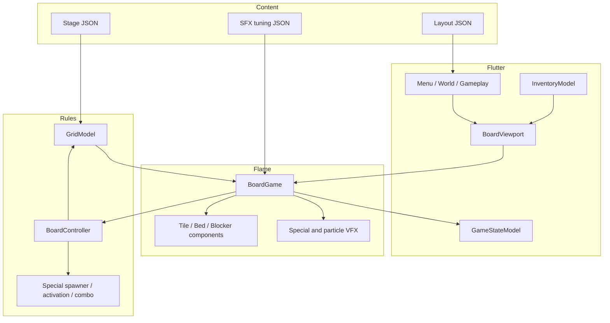
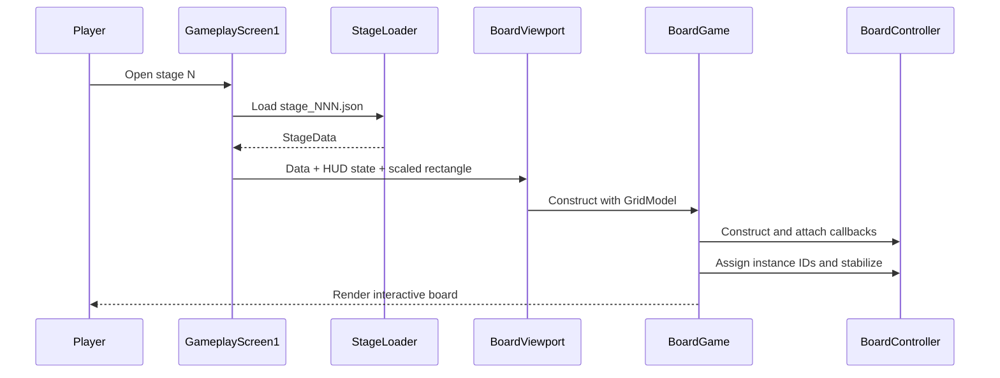
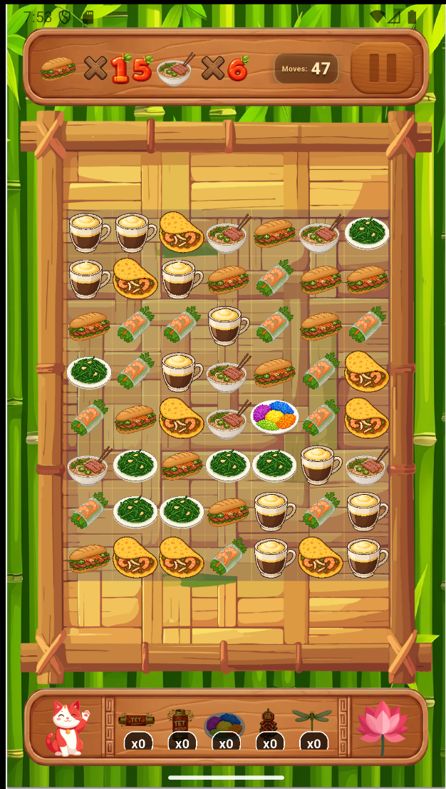
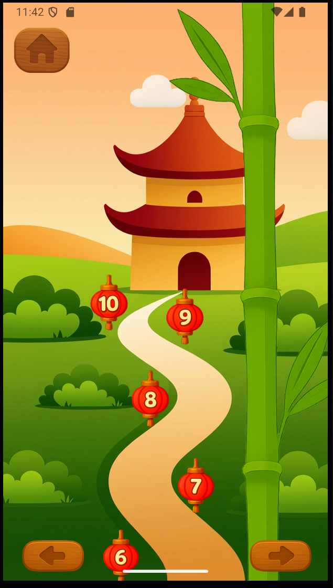
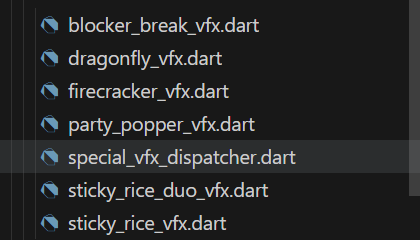
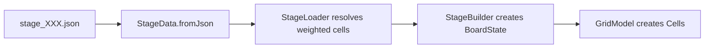
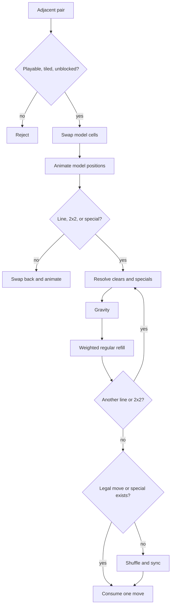
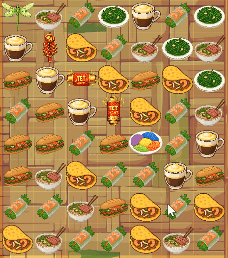
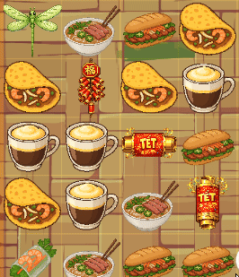
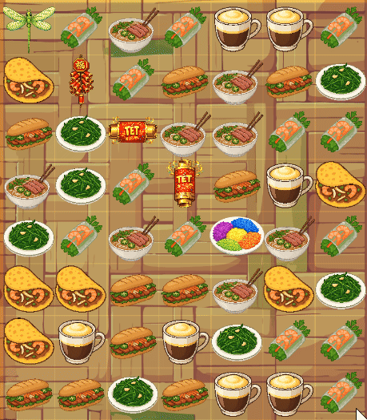

# Technical Overview

<p class="section-kicker">Code-traceable engineering narrative</p>

This page explains how Pho Logic turns stage data and player input into a
stable, animated match-3 board. It focuses on the architectural choices that
carry the most risk: logical/render state separation, asynchronous turn
ordering, special-effect timing, data-authored content, and local persistence.

!!! important "Scope"

    Pho Logic is a student portfolio project. The description below is based
    on version `1.0.0+6` in the repository. Platform wrapper directories show
    intended Flutter targets; they do not prove that every target has passed a
    release qualification process.

<div class="doc-actions">
  <a class="md-button md-button--primary" href="architecture.html">Full architecture reference</a>
  <a class="md-button" href="gdd.html">Game Design Document</a>
  <a class="md-button" href="https://github.com/CuongMe/pho_logic_mvp">Source repository</a>
</div>

## Executive Summary

Pho Logic uses a hybrid Flutter/Flame architecture:

- **Flutter** owns application startup, routing, screen layout, HUD state,
  dialogs, settings, inventory gestures, and safe-area scaling.
- **Flame** owns the embedded board scene, tile components, movement,
  selection feedback, particles, and special VFX.
- **Pure Dart models and services** own the logical grid, swaps, matches,
  special rules, gravity, refill, objective progress, and persistence.

The central rule is that `GridModel` is authoritative. Rendering is a
projection. A tile's logical coordinate can change many times during one turn,
so `tileInstanceId` preserves identity while Flame animates an existing
component to its new location.



## Technology and Dependency Surface

| Layer | Technology | Repository role |
| --- | --- | --- |
| Language/runtime | Dart `>=3.0.0 <4.0.0` | Application, rules, and tooling language |
| UI framework | Flutter | Screens, layout, dialogs, routing, and platform shell |
| Game engine | Flame `^1.22.1` | Board scene, components, callbacks, and effects |
| Short SFX | `flame_audio` | Pooled event sounds |
| BGM | `audioplayers` | Looping background tracks |
| Local state | `shared_preferences` | Inventory, results, language, and cooldown |
| External actions | `url_launcher` | Optional Google Forms feedback |
| Logging | `logger` plus project wrappers | Debug diagnostics |
| Windows packaging | `msix` | MSIX configuration |

No backend client, account SDK, cloud database, analytics SDK, dependency
injection framework, or Google Mobile Ads package is declared in the current
`pubspec.yaml`.

## Repository Boundaries

```text
lib/src/
|-- app/                 MaterialApp and routes
|-- audio/               Global BGM and SFX managers
|-- game/
|   |-- board/           Rule orchestration, board rendering, and special logic
|   |-- inventory/       Booster data and persistence
|   |-- model/           Grid, cell, coordinate, and match records
|   |-- progress/        Latest stage result
|   |-- stages/          Parse, build, and validate stage data
|   |-- utils/           Weighted picking and debug logging
|   `-- vfx/             Effect-specific Flame sequences
|-- screens/             Menu, world, gameplay, help, settings, and modals
|-- utils/               JSON/layout helpers and cooldown
`-- widgets/             Reusable Flutter UI
```

This organization follows runtime ownership rather than framework type alone.
For example, `BoardGame` lives with game-board code even though it is a Flame
class, while `BoardViewport` lives with gameplay screens because it bridges
Flutter layout and Flame input coordinates.

## Startup and Screen Flow

`main.dart` initializes Flutter, applies a mobile-only orientation lock,
initializes both audio managers, and runs `PhoLogicApp`. The app installs a
global navigator key and a pointer listener used to retry browser BGM after a
user gesture.

`Routes.getRoutes()` registers the menu, one world map, and 25 generated
gameplay paths:

```text
/menu
/world/1
/gameplay/1 ... /gameplay/25
```

The gameplay route owns a new session. It loads the shared gameplay-layout JSON
and the selected stage JSON, creates `GameStateModel`, embeds
`BoardViewport`, and listens for derived win/loss changes.



## JSON-authored Presentation

Menu, world, and gameplay layouts share a 1080x1920 design coordinate space.
For each screen:

```text
scale = min(usableWidth / 1080, usableHeight / 1920)
```

The scaled design is centered in the safe area. Web scale is capped at
`1.0`. Position and size values remain in the authoring coordinate space and
are transformed into screen pixels at build time.

Gameplay defines a separate board rectangle:

```json
{
  "gridRect": {
    "x": 120,
    "y": 325,
    "w": 850,
    "h": 1260
  }
}
```

`BoardViewport` occupies that rectangle. `BoardGame` then computes tile
size using the smaller of viewport-width-per-column and
viewport-height-per-row, ensuring that the complete 8x7 grid fits.

**Trade-off:** contain scaling preserves the original composition and avoids
per-device hardcoding, but very different aspect ratios can produce unused
space. JSON also moves some errors from compile time to runtime.

<div class="media-grid">
  <figure>
    
    <figcaption>Flutter HUD composition around the Flame board viewport.</figcaption>
  </figure>
  <figure>
    
    <figcaption>Five-lantern page composition in the world screen.</figcaption>
  </figure>
  <figure>
    
    <figcaption>Portfolio diagram supporting the VFX implementation narrative.</figcaption>
  </figure>
</div>

## Stage Data Pipeline

Every current stage is an 8x7 JSON file with:

- Regular tile definitions and spawn weights.
- Bed types and `bedMap`.
- Optional blocker definitions.
- `tileMap` initial content.
- Move budget and collection objectives.
- `allowInitialMatches`.

The current sentinel values are `0` weighted spawn, `-1` void, `-2`
scooter blocker, and positive fixed tile IDs.



`StageValidator` checks dimensions, references, and weights, but the runtime
load path does not call it. `StageLoader` and `StageBuilder` also both own
weighted-spawn logic. Consolidating those responsibilities would make
initial-match prevention and validation easier to reason about.

## Logical Board Model

`GridModel` contains a matrix of `Cell` objects. A cell can carry a regular
or special type ID, a stable instance ID, a bed ID, and blocker state.
`Coord(row, col)` is immutable and acts as the common key between rules,
rendering, VFX, and objective events.

### Core Invariants

1. A cell with `bedId == -1` is outside play.
2. A blocker occupies its own cell, rejects swaps, and divides gravity.
3. Regular tile IDs are below `101`; special IDs are `101..105`.
4. Refill creates only regular tiles.
5. A moved tile preserves `tileInstanceId`.
6. A newly refilled tile receives a new instance ID.
7. Rendering registries must converge to the model after each sync.

These invariants matter because one turn can mutate many coordinates before
animation completes. Identity-by-coordinate would be ambiguous during swaps
and gravity.

## Turn Transaction

`BoardGame` accepts two adjacent taps and delegates to
`BoardController.attemptSwap()`. A busy flag blocks overlapping input until
the transaction returns.



The controller calls an asynchronous `onSync` callback after mutation
boundaries. `BoardGame` uses it to run `syncFromModel()` and then
`validateBoardSync()`. This creates a transaction-like rhythm without
coupling the rule engine to Flame classes.

### Match Detection

Line detection scans regular tiles horizontally and vertically. It ignores
voids, blockers, empty cells, and special IDs. A simulated validity check
accepts a swap that creates a line, a same-type regular 2x2 around the swap, or
includes a special.

### Clear, Gravity, and Refill

Before clearing, the controller captures `coord -> regular tile type`. That
event supports both objective progress and object-specific particles after
the model cells have been emptied.

Gravity works in vertical segments. A blocker stops traversal, so a tile above
it never falls through to the segment below. Refill fills only empty,
playable, non-blocker cells from stage-authored regular weights.

The cascade loop has a 10-pass safety cap. When stable, the board shuffles only
if it has no possible move and no special tile.

## Special System

Special behavior is divided into three policies:

1. `SpecialTileSpawner` recognizes creation patterns and chooses spawn cells.
2. `SpecialActivationResolver` computes a normal swap activation.
3. `SpecialComboResolver` expands a special-to-special pair into ordered
   steps.

| ID | Created by | Logical effect |
| ---: | --- | --- |
| `101` | Four horizontal | Playable row |
| `102` | Four vertical | Playable column |
| `103` | Five straight | All regular tiles matching its swap partner |
| `104` | T/L union of 5 or 6 | Centered playable 3x3 |
| `105` | Same-type regular 2x2 | Swap partner plus one deterministic target and source cleanup |

Candidates are sorted Sticky Rice, Firecracker, Dragon Fly, then Party Popper.
The spawner greedily accepts non-overlapping patterns and protects each
accepted spawn coordinate from the clear set.

The combo resolver does not simply union two effects. It returns ordered
`ComboStep` records, allowing color clears, pre-hits, row/column clears, and
3x3 effects to run in a defined sequence. The [GDD combination matrix](gdd.md#special-combinations)
records every current pair.

<div class="media-grid special-power-grid">
  <figure>
    
    <figcaption>Horizontal Party Popper uses projectile timing for row-clear feedback.</figcaption>
  </figure>

  <figure>
    
    <figcaption>Sticky Rice Bomb clears every regular tile of the selected partner type.</figcaption>
  </figure>
  <figure>
    
    <figcaption>Firecracker owns the visible centered 3x3 impact.</figcaption>
  </figure>
  <figure>
    
    <figcaption>Dragon Fly target metadata keeps flight and logical clearing aligned.</figcaption>
  </figure>
</div>

## Flame Rendering and Synchronization

`BoardGame` extends `FlameGame` with tap callbacks and a fixed-resolution
camera matching the Flutter viewport. It owns:

| Registry | Role |
| --- | --- |
| `tilesByInstanceId` | Stable identity to tile component |
| `instanceAtCoord` | Current coordinate to instance |
| `coordByInstanceId` | Instance to current coordinate |
| `bedComponents` | Static bed component by cell |
| `blockerComponents` | Scooter component by cell |

`syncFromModel()` builds replacement coordinate maps, animates existing
components whose instance IDs moved, updates sprite types, creates missing
components, and removes orphans. It replaces the coordinate maps as a unit.

`validateBoardSync()` is a defensive repair pass. It is valuable while the
prototype evolves, but repeated repair should not substitute for proving each
mutation preserves the registry invariants.

### Clear and VFX Timing

VFX ownership differs by effect:

- Party Popper and Firecracker clear cells at exact impact times by calling
  back into `BoardGame.clearTilesAtCoords()`.
- Sticky Rice and Dragon Fly animate using target metadata, then the
  controller completes their logical clear path.
- A suppression set prevents automatic burst particles where the special VFX
  already emitted an impact.
- Specials caught in another special's affected set are removed without
  recursively starting another VFX.

This design avoids uncontrolled overlapping animations, but it also means the
game does not implement general special-chain propagation.

## Objectives and Blockers

`GameStateModel` owns moves, collection progress, initial/remaining blocker
counts, and derived terminal states.

```text
won  = all collection objectives complete
       AND (no initial blockers OR blockers remaining == 0)

lost = moves remaining <= 0 AND not won
```

Only captured regular victim IDs update collection progress. Special IDs are
filtered out.

A scooter blocker:

- Rejects swaps.
- Occupies a cell without a tile.
- Stops gravity across its position.
- Breaks from an adjacent regular-match clear.
- Does not currently break from a special clear.
- Must be removed to win any stage that started with scooters.

The blocker-break callback plays an exit animation before the controller
removes the pending blocker and decrements game-state count.

## Inventory and Persistence

`InventoryRepository` stores a JSON map of special ID to count under
`player_inventory_v4`. Defaults are zero. A booster drag can replace a
playable regular tile with its special ID; the inventory then spends one item
and the board synchronizes.

!!! warning "Non-atomic booster transaction"

    Placement currently occurs before the asynchronous inventory spend. If
    spending fails, the code logs an error but does not restore the original
    tile. A production-quality implementation should reserve/spend first or
    model placement and spend as one rollback-capable operation.

Stage progress stores the latest `cleared` or `lose` result by stage.
Language and the 45-second free-boost timestamp also use local preferences.
There is no first-party account or cloud synchronization layer.

## Audio

`SfxManager` uses Flame `AudioPool` for low-latency event sounds and reads
per-sound settings from `assets/audio/sfx_tuning.json`. `BgmManager` uses
`audioplayers` for looping menu, gameplay, and festival tracks.

Browser autoplay can reject BGM startup. Instead of treating that as a fatal
error, the manager retains a pending request and retries after the app-level
pointer listener observes user interaction.

Global singleton managers are pragmatic at this project size. The trade-off is
testability: call sites cannot replace them without additional seams.

## Implemented Performance Measures

- Tile-definition and bed-definition maps avoid repeated linear lookup.
- Stable instance registries avoid rebuilding every moving tile.
- Sound effects are pooled and preloaded.
- Stage files are loaded on demand.
- Large clears reduce generic particle complexity.
- Input is serialized by the board busy flag.
- The cascade loop and shuffle attempts use safety limits.
- Web layouts do not upscale beyond the 1080x1920 design reference.

These measures are visible in code. The repository does not include frame-time
profiles, memory traces, device matrices, or benchmark results, so numerical
performance claims would be unsupported.

## Failure Handling

| Failure area | Current behavior |
| --- | --- |
| Stage/layout load | Screen catches and shows an error state |
| Audio startup | Logs failure; web BGM can retry after interaction |
| Inventory load | Falls back to defaults and saves them |
| Invalid swap | Restores original cells and does not spend a move |
| No legal move | Shows a wait modal and shuffles |
| Render/model drift | `validateBoardSync()` repairs missing or orphaned components |
| Cascade runaway | Stops after 10 passes and logs a warning |

Logging is extensive and useful during development, but many hot paths produce
verbose output. Release builds should define a deliberate logging policy.

## Testing and Verification Status

The repository currently has no meaningful automated coverage.
`test/widget_test.dart` is Flutter's counter-app example and references a
`MyApp` class absent from this project.

The highest-value test order is:

1. Pure match, 2x2, gravity, solvability, and special-resolver tests.
2. A content test that parses and validates all 25 stages.
3. Seeded board tests for initialization and shuffle postconditions.
4. Widget tests for routes, HUD updates, and terminal dialogs.
5. Integration tests for a full valid/invalid turn and booster rollback.
6. Golden screenshots for menu, world, and gameplay compositions.

The [architecture testing strategy](architecture.md#testing-strategy) defines
the expected cases in more detail.

## Known Constraints

| Severity | Constraint | Consequence |
| --- | --- | --- |
| High | Win next-stage logic uses `<= 20` | Stage 20 returns to the world instead of advancing into the five-stage endgame |
| High | Booster placement/spend is not atomic | Inventory and board can diverge |
| High | Automated test scaffold is invalid | No reliable regression gate |
| Medium | Stage validation is disconnected | Bad content can fail late |
| Medium | Weighted spawn has duplicate ownership | Initialization policy is harder to prove |
| Medium | Stage 21 zero-weight fixed specials conflict with validator rules | Test-arena content cannot pass the validator as currently written |
| Medium | Special and regular clears affect scooters differently | Design and implementation must stay explicitly aligned |
| Low | A stale Android activity exists under an older package path | Platform configuration is noisier than necessary |
| Low | Web manifest still contains scaffold metadata | Installed-web presentation is inconsistent with the game |

## Advertising Learning Exercise

The site and repository retain `app-ads.txt` for a demo AdMob/app-publishing
exercise. The current source does not initialize an ads SDK and the package
manifest does not declare Google Mobile Ads. The active reward path grants
local boosters after a prototype cooldown.

This distinction matters in a portfolio: learning intent can be documented
without implying a production monetization integration.

## Engineering Takeaways

The strongest part of this implementation is the decision to separate logical
board truth from frame-timed presentation. That enables:

- Deterministic reasoning about swaps and cascades.
- Stable visual identity across coordinate mutations.
- Special effects that can stage their impact without becoming the owner of
  objective progress.
- JSON-authored content that does not modify the core rule engine.

The next quality step is not more features. It is tightening contracts:
connecting validation, removing duplicate ownership, making inventory
transactions atomic, fixing campaign navigation, and establishing deterministic
tests. Those changes would turn a capable student MVP into a substantially more
reliable engineering portfolio artifact.

## Continue Reading

- [System Architecture](architecture.md)
- [Game Design Document](gdd.md)
- [Board Engine Guide](board-game.md)
- [BoardGame Rendering Reference](board-game-rendering.md)
- [BoardController Rules Reference](board-controller.md)
